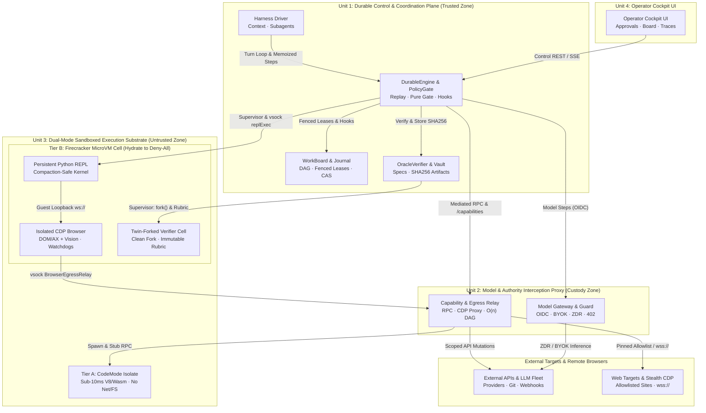
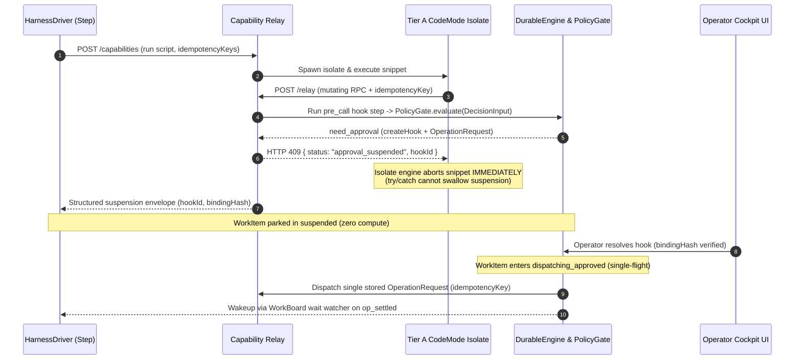
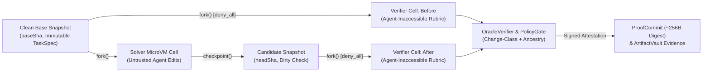

# Crucible — Clean-Slate Frontier Agentic Engineering Blueprint

> **Clean-Slate Architectural Specification**  
> **Core Thesis:** **Crucible** splits frontier autonomous engineering into **four cohesive, wire-coupled units**—a **Durable Control & Coordination Plane** (TypeScript + Workflow DevKit semantics), a **Model & Authority Interception Proxy**, a **Dual-Mode Sandboxed Execution Substrate** (sub-10ms stateless Code Mode isolates + hardware-isolated Firecracker MicroVMs hosting a persistent Python REPL and scoped CDP Browser), and an **Operator Cockpit UI**—governed by fail-closed per-call interception, zero-compute human suspension, and twin-forked isolated verification.

---

## 1. Product Thesis & First-Principles Architecture

Production agentic software engineering breaks down when harnesses conflate **trusted authority** with **untrusted execution**, drown model context windows in raw tool schemas and intermediate logs, or allow solver agents to certify their own outputs. Crucible resolves these failure modes from first principles without monolithic package coupling or legacy runtime assumptions.

### 1.1 Five Structural Pathologies Solved

1. **Tool Schema Bloat vs. Context Hygiene:** Exposing thousands of flat JSON tool schemas consumes hundreds of thousands of tokens before reasoning starts, while sequential tool loops echo bulky intermediate payloads through every prompt turn. Crucible pairs a fixed **~1,000-token `discover` + `run` Code Mode surface** (for external API orchestration) with an **in-cell persistent Python REPL** (keeping ASTs, dataframes, and bulk logs in kernel variables) and **content-addressed opaque handles (`artifact://sha256:<hex>`)** across boundaries.
2. **Stateless API Mediation vs. Stateful Repo Computation:** Stateless V8/Wasm isolates excel at sub-10ms API batching with zero ambient credentials, yet cannot run multi-minute compilers, retain Python state across compaction, or drive Chromium. Conversely, stateful microVMs excel at persistent builds, Python analysis, and CDP browser automation, yet must never hold long-lived API secrets. Crucible implements a **Dual-Mode Execution Substrate** uniting both tiers behind one fail-closed policy gate.
3. **Blocking Approvals vs. Durable Zero-Compute Suspension:** Holding an ephemeral isolate or foreground worker thread open during a multi-minute human review wastes compute, hits HTTP deadlines, and invites partial-batch corruption. Crucible couples **Workflow DevKit deterministic replay** with **immediate isolate abort on `409 approval_suspended`**, parking tasks at **zero compute** until an authenticated operator resolves the bound `ApprovalHook`.
4. **Ambient Trust vs. Hardware & Wire Isolation:** Letting an agent REPL read host environment variables, `.git/hooks`, or arbitrary metadata IPs (`169.254.169.254`) turns every prompt injection into credential theft. Crucible keeps all static secrets in a wire-level **CredentialVault**, confines untrusted execution inside **two-phase egress-locked Firecracker MicroVMs (`hydrate` → `deny_all`)**, and scopes browser automation to an isolated `BrowserContext` with `Fetch`/`Network` origin guards.
5. **Self-Attested Verification & Quadratic Traces:** Letting a solver agent run tests in its own mutable container invites test tampering, while flat transcript logging scales $O(n^2)$ in token re-serialization. Crucible separates **`TaskSpec × Harness × Cell`**, forks an independent **Twin-Forked Verifier Cell** seeded with immutable agent-inaccessible rubrics, enforces semantic HTTP-200 validation, and captures an **$O(n)$ compaction-aware `TraceDAG`**.

### 1.2 First-Principles Language, Runtime & Packaging Split

Crucible deliberately rejects a single-language monolith. Instead, it separates into **four cohesive wire-coupled units** selected strictly by workload, isolation, and boundary properties:

| Unit | Primary Runtime & Language | Workload Profile | Why This Choice From First Principles |
|---|---|---|---|
| **1. Control & Coordination Plane** (`control-plane`) | **TypeScript** (strictly typed runtime + Workflow DevKit semantics) | Event-sourced `WorkBoard` DAG/leases, deterministic replay (`workflow` vs. `step`), pure `PolicyGate`, `ArtifactVault`, `OracleVerifier`, `HarnessDriver` | Deterministic replay requires strict separation between pure orchestration and side-effect steps; TypeScript unifies Workflow DevKit semantics, JSON-Schema canonicalization, and typed UI/SSE contracts without embedding untrusted Python or browser binaries. |
| **2. Model & Authority Interception Proxy** (`wire-proxy`) | **Low-overhead HTTP/SSE Wire Proxy** (TypeScript / systems proxy edge) | High-concurrency streaming `/v1/inference`, OIDC token minting, BYOK vault custody, `zeroDataRetention` routing, `402` spend caps, semantic HTTP-200 inspection, `CapabilityRelay`, `TraceDAG` | Credential custody, spend governance, ZDR compliance, and token-exact trace capture must sit outside agent and sandbox memory so neither prompt injections nor compromised cells can read keys or forge usage telemetry. |
| **3. Dual-Mode Sandboxed Execution Substrate** (`execution-substrate`) | **Tier A:** V8/Wasm Isolate Engine **Tier B:** Firecracker Linux MicroVM + **Python** (`py-kernel` + `cdp-browser`) | **Tier A:** Sub-10ms single-use `discover`/`run` API batching. **Tier B:** Persistent IPython/CPython REPL, repo toolchains, raw WebSocket CDP Chromium, Twin-Forked Verifier Cell | Frontier models reason fluently in JS/TS for fast zero-state API batching and in Python for persistent AST/data manipulation and raw CDP browser control. Isolates guarantee sub-10ms zero-secret API orchestration; Firecracker microVMs contain unrestricted Python + Chromium behind hypervisor and netns walls. |
| **4. Operator Cockpit UI** (`cockpit-ui`) | **Authenticated Web Console** (SPA over `/control` REST + SSE) | Live `WorkBoard` DAG view, `ApprovalInbox`, live MicroVM `Stage` previews, dual Developer/Business `TraceDAG` & `ProofCommit` inspector | Operators require real-time visibility and cryptographic approval signing without granting browser UIs direct database, vault, or sandbox shell access. |

All cross-unit boundaries are defined by **language-neutral wire and JSON-Schema contracts** in [`docs/architecture/CONTRACTS.md`](docs/architecture/CONTRACTS.md).

---

## 2. System Topology & Four-Unit Trust Boundaries

### 2.1 High-Level Topology & Trust Zones

Every unit operates in the minimal trust zone required for its responsibility. Static provider keys, signing keys, and durable state never cross into the Execution Substrate.

### 2.2 Trust Boundary Guarantees (`BND-01`–`BND-05`)

| Boundary | Guarantee | Enforcement Mechanism |
|---|---|---|
| **`BND-01` Secret Custody** | Neither `HarnessDriver`, `CodeMode Isolate`, nor `MicroVM Cell` can read long-lived API keys, provider credentials, or signing keys (including stealth CDP keys). | `CredentialVault` resides exclusively inside `wire-proxy` / `control-plane`; workloads receive short-lived OIDC or capability session tokens only, and `BrowserEgressRelay` injects stealth-provider keys inside `Unit 2`. |
| **`BND-02` Isolate Containment** | `CodeMode Isolate` (Tier A) has zero filesystem, zero environment variables, zero raw network (`globalOutbound: null`), and single-use teardown. | Host engine instantiates an empty V8/Wasm isolate per snippet, injects secret-free RPC stubs, and destroys the isolate on completion or `409` abort. |
| **`BND-03` MicroVM Egress Lock** | Untrusted code, verification checks, and browser runtimes inside `MicroVM Cell` (Tier B) emit **0** direct TCP, UDP, or DNS packets to the internet or host metadata IPs. | Two-phase `networkPolicy` transitions atomically from `hydrate` (package registry allowlist) to `deny_all` (`allowDns: false`, `allowBrokerSocket: true` over `virtio-vsock`/Unix socket); all outbound `cdp-browser` HTTP(S) and optional stealth `wss://` traverse `allowBrokerSocket` to host-side `BrowserEgressRelay` in `Unit 2`. |
| **`BND-04` Workspace Safety** | Untrusted repositories cannot alter policy rules, lifecycle hooks, or host Git execution. | `PolicyGate` reads rules solely from signed `TaskSpec` bundles; `SafeGitObserver` queries bare mirrors with hooks and `fsmonitor` disabled (`INV-07`). |
| **`BND-05` Grader Independence** | Solver cells never modify verification rubrics or certify their own outputs (`scoringMode: "isolated"`). | `OracleVerifier` forks a clean `Twin-Forked Verifier Cell` from base/candidate snapshots with immutable rubric mounts and cryptographic `authorPrincipals` exclusion (`INV-11`). |

---

## 3. Original Synthesis of Architectural Inspirations

Crucible synthesizes seven primary architectural lineages into cohesive, original primitives—without copying external source implementations or binding core contracts to third-party frameworks.

| Source Lineage | Core Problem Solved | Crucible Original Abstraction | Unit Ownership |
|---|---|---|---|
| **Prime Intellect** (`verifiers`, `prime-rl`, Sandboxes) | Prevents test tampering, $O(n^2)$ trace blowup, and policy/spec drift during async rollouts. | **Orthogonal `TaskSpec × Harness × Cell`**, **Twin-Forked Verifier Cell** (`isolated` scoring), **$O(n)$ `TraceDAG`** pinned to `(specVersion, policyVersion, harnessVersion)`, **`maxAsyncStaleness`**, `checkpoint()`/`fork()`/`pause()`/`resume()`, and compact **`ProofCommit`**. | Unit 1 (`OracleVerifier`) + Unit 2 (`TraceDAG`) + Unit 3 (`MicroVM Cell`) |
| **Cloudflare Code Mode** | Eliminates >1M-token JSON tool catalogs while running model-authored API scripts safely. | **~1,000-token `discover` + `run` surface**, **lazy `$ref`-sliced `SpecIndex`**, **Tier A `CodeMode Isolate`** (<10ms, `globalOutbound: null`), **secret-free host RPC stubs**, and **idempotent batched dispatch**. | Unit 2 (`CapabilityRelay`) + Unit 3 (Tier A `CodeMode Isolate`) |
| **Claude Code Mode & PTC** | Stops intermediate payloads from flooding prompts while preserving strict per-call governance. | **Opaque `artifact://sha256` handle passing**, **fail-closed `PolicyGate`** (`deny > ask > allow` + memoized `HookOutcome[]`), **downward-narrowing subagent delegation** (inherited hooks + subset grants), and **suspend/resume across host tool calls**. | Unit 1 (`PolicyGate`, `ArtifactVault`, `HarnessDriver`) |
| **Unharnessed** | Eliminates rigid file/search tool chunking via persistent code execution surviving compaction. | **Tier B `py-kernel` (Persistent Python REPL + async `shell()` via `replExec`)** retaining imports, ASTs, and synthesized helpers across transcript compaction—safely wrapped in a MicroVM with cgroups RAM/PID limits, configurable `reapScope`, and compaction manifests. | Unit 1 (`HarnessDriver`) + Unit 3 (Tier B `py-kernel`) |
| **Browser Use** | Overcomes heavy WebDriver wrappers, stale DOM IDs, cookie leakage, and bot walls. | **Tier B `cdp-browser`** pairing `py-kernel` with **raw typed CDP** (guest `ws://` + `Unit 2 BrowserEgressRelay` for external HTTP(S)/stealth `wss://`), **hybrid DOM/AX + vision perception**, **watchdogs**, **isolated `BrowserContext`**, and **`blockPrivateCidrs`/DNS-pinning + HTTP-200 challenge guards**. | Unit 3 (Tier B `cdp-browser`) + Unit 2 (`BrowserEgressRelay`, `SemanticGuard`) |
| **Vercel Board & Workflows** | Replaces brittle workspace `STATUS.md` files and polling loops with durable coordination. | **`WorkBoard`** (scoped channels, threads, dependency DAG `WorkItem`s, generation-fenced TTL leases, `wait` watchers, human escalations) + **`DurableEngine`** (`workflow` deterministic replay vs. memoized `step`, zero-compute `createHook`/`createWebhook`/`sleep`). | Unit 1 (`WorkBoard`, `DurableEngine`) |
| **Vercel Sandbox & AI Gateway** | Aligns VM lifecycle/billing to LLM wait profiles and centralizes model custody/compliance. | **`MicroVM Cell`** (`checkpoint()`/`snapshot()`/`fork()`, two-phase mutable `networkPolicy`, Active CPU billing + idle snapshot rollover) + **`ModelGateway`** (OIDC short-lived auth, BYOK vault, virtual aliases/fallbacks, `zeroDataRetention`, `402` spend caps, trace drains). | Unit 2 (`ModelGateway`, `CredentialVault`) + Unit 3 (Tier B `MicroVM Cell`) |

---

## 4. Detailed Subsystem Design

### 4.1 Unit 1: Durable Control & Coordination Plane (`control-plane`)

1. **`WorkBoard` (Headless Multi-Agent Coordination Fabric):**
   - **Channels & Threads:** Work is organized into scoped channels (`project`, `run`, `swarm`) and threads carrying status updates, `TraceDAG` links, `artifact://` references, and human escalations, with optional two-way external tracker sync.
   - **Dependency DAG & Fenced TTL Leases (`INV-09`):** Every `WorkItem` declares `dependsOn: WorkItemId[]` and initializes at `generation: 1` upon creation. Workers claim `ready` tasks atomically via `claimReady({ channelId, principalId, ttlMs })` receiving `{ leaseToken, generation }` (`>= 1`). Expired/released leases, `invalidated_by_tip_change`, and retryable verification failures return tasks to `ready` and increment `[gen++]`; all journal and state commits verify `actionGeneration === currentGeneration` and `expectedSequence` CAS inside serialized transactions (rejecting stale writers with `409 Conflict / FencedWriter`). When an approved `ApprovalHook` triggers an `OperationRequest`, the item locks into `dispatching_approved` until the single-flight operation settles so concurrent workers cannot re-claim `ready` mid-dispatch.
   - **Event-Driven `wait` Watchers & Downward-Narrowing Delegation (`INV-03`):** Agents suspend on `wait({ target })` streams instead of polling. When `HarnessDriver` delegates a subtask (`spawnChild`), the child `WorkItem` inherits all parent `PolicyGate` lifecycle hooks and receives a capability ceiling that is strictly a subset of the parent's grant (`childGrant <= parentGrant`, including `allowedBindings` and `allowedMethods` subset narrowing).
2. **`DurableEngine` (Deterministic Replay & Outbox Reconciliation):**
   - **Replay vs. Side-Effect Split (`INV-08`):** Orchestration logic runs inside a pure deterministic `workflow` loop (no direct network, filesystem, or wall-clock reads) driven off an immutable, hash-chained event journal. All external I/O—including `ModelGateway` turns, `CapabilityRelay` calls (`POST /capabilities`), Host Hypervisor Supervisor API calls (`provision`, `setNetworkPolicy`, `checkpoint`/`snapshot`, `fork`, `pause`, `resume`, `stop`), In-Guest `vsock` Daemon RPCs (`replExec`, `cdpAttach`), and lifecycle hook execution (`pre_call`, `post_call`)—executes inside memoized `step` boundaries returning `FatalError` (halt immediately) or `RetryableError` (exponential backoff with `retryAfter`).
   - **Version Pinning:** Every `Run` pins `{ specVersion, policyVersion, harnessVersion, deploymentVersion }` at start so code deployments or `/refine` promotions never break active replay trajectories.
   - **Idempotent Outbox (`INV-10`):** Mutating steps persist an `OperationRequest` keyed by a deterministic `idempotencyKey` before dispatch. Worker crashes after external dispatch transition the operation to `uncertain_pending`, halting blind retries until provider lookup reconciles the single outcome (or returns `reconciled_absent` to `pending` when absence is proven) or escalates to an operator.
3. **`PolicyGate` & `ArtifactVault`:**
   - **Hook Execution vs. Pure Evaluation (`INV-05`, `INV-08`):** Crucible strictly separates **Hook Execution** from **Pure Evaluation**:
     1. *Hook Execution (`DurableEngine` `step`):* `pre_call` hooks execute in a memoized `step` before policy evaluation (and `post_call` hooks in a memoized `step` after capability dispatch), recording immutable `HookOutcome[]` entries (`{ hookId, phase, status: "ok" | "timeout" | "error" | "malformed", verdict?, reasonCode? }`) into the event journal.
     2. *Pure Evaluation (`PolicyGate.evaluate(DecisionInput) -> DecisionOutput`):* Evaluates every capability call, workflow stage transition, `WorkItem` transition, trace promotion, and `/refine` promotion deterministically with **zero I/O, zero network, and zero wall-clock reads** over canonicalized `DecisionInput` (including explicit `nowUtc`, pinned versions, and pre-recorded `HookOutcome[]`) in strict precedence **`deny > ask > allow`**. Any `HookOutcome` with `status` in `["timeout", "error", "malformed"]` resolves deterministically to `deny`.
   - **Cryptographic Principals (`INV-11`):** Every actor carries a persistent `PrincipalIdentity` and `SignedAttestation` (`Ed25519` or `HMAC-SHA256` verified by `control-plane`). Self-verification (`authorPrincipalId` matching verifier/reviewer/curator) is rejected regardless of session ID or claimed role label.
   - **Content-Addressed `ArtifactVault`:** Bulky logs, diffs, DOM snapshots, screenshots, and model payloads are written atomically, fsynced, addressed as `artifact://sha256:<hex>`, and gated by per-`(runId, channelId)` `artifact_grants`.

### 4.2 Unit 2: Model & Authority Interception Proxy (`wire-proxy`)

1. **`ModelGateway`, `CredentialVault` & `SemanticGuard`:**
   - **Zero Static Secrets (`INV-04`):** Agents and sandboxes authenticate with short-lived project-scoped OIDC or session tokens. `CredentialVault` injects BYOK provider keys (and stealth CDP provider keys inside `BrowserEgressRelay`) solely on the upstream proxy leg.
   - **Routing, ZDR & Budget Caps:** Virtual model aliases map to provider fallbacks while honoring `zeroDataRetention: true` (skipping non-ZDR BYOK credentials). Exceeded team/run budgets return hard **HTTP `402`**, triggering clean workflow checkpointing; upstream `429`/`5xx` spikes trip **fleet-shared circuit breakers** and admission leases.
   - **Semantic HTTP-200 Failure Guard (`INV-12`):** Even when an upstream LLM or web endpoint returns `HTTP 200 OK`, `SemanticGuard` inspects payloads for empty tool arguments, truncated JSON, model safety refusals, or anti-bot interstitials (Cloudflare/CAPTCHA/login walls), flagging a non-`ok` `ModelCall.semanticStatus` (`empty_tool_args` | `truncated_json` | `refusal_on_200` | `bot_challenge_200` | `schema_mismatch`) and emitting `ProofArtifact` `blockedCause: "semantic_http_200_failure"` so defective responses never masquerade as success.
2. **`CapabilityRelay`, `BrowserEgressRelay` & Zero-Compute Approval Suspension (`INV-06`, `INV-10`):**
   - **`CapabilityRelay`:** Mediates `POST /capabilities` (spawning Tier A `CodeMode Isolate` on behalf of `HarnessDriver`'s memoized `step`), snippet RPC calls (`POST /relay`), lazy schema slice fetches (`POST /relay/spec/describe`), and artifact transfers (`POST /relay/artifacts/put`, `GET /relay/artifacts/:sha256`).
   - **`BrowserEgressRelay` (`BND-01`, `BND-03`):** Terminates all outbound `cdp-browser` HTTP(S) target fetches and optional remote cloud stealth `wss://` CDP sessions coming from `MicroVM Cell` over `allowBrokerSocket` (`virtio-vsock`/Unix socket). Injects stealth-provider credentials from `CredentialVault`, enforces `originAllowlist`, enforces `blockPrivateCidrs` (IPv4 RFC1918 `10.0.0.0/8`, `172.16.0.0/12`, `192.168.0.0/16`; IPv4 loopback/link-local `127.0.0.0/8`, `169.254.0.0/16`; IPv6 loopback/link-local/ULA `::1/128`, `fe80::/10`, `fc00::/7`), performs post-DNS-resolution IP pinning (DNS-rebinding rejection), and routes responses through `SemanticGuard`.
   - **Batched Suspension Sequence:**

3. **$O(n)$ Compaction-Aware `TraceDAG`:**
   - Captures every model turn and tool/REPL event as nodes in an append-only DAG rather than flattening transcripts at every turn ($O(n)$ storage vs. $O(n^2)$).
   - Supports dual capture profiles (`eval` normalized spans vs. `train` token-ID exact boundaries), records explicit `CompactionBoundary` nodes, tags every node with `(specVersion, policyVersion, harnessVersion)` plus `asyncStalenessLevel`, and enforces `asyncStalenessLevel <= taskSpec.maxAsyncStaleness` (via `PolicyGate` / `OracleVerifier`) before trace promotion or `/refine` evaluation.

### 4.3 Unit 3: Dual-Mode Sandboxed Execution Substrate (`execution-substrate`)

Crucible pairs two complementary execution tiers—both completely isolated from static credentials—selected dynamically by task workload:

1. **Tier A — `CodeMode Isolate` (Ephemeral API Orchestration):**
   - **Progressive Two-Tool Surface (`INV-01`):** Exposes exactly two model-facing tools—`discover({ code })` and `run({ code })`—totalling **$\le 1,200$ tokens** and byte-identical from 5 to 5,000+ granted endpoints.
   - **Invocation Lifecycle:** `HarnessDriver` (inside a memoized `DurableEngine` `step`) calls `POST /capabilities` on `CapabilityRelay`, which spawns the ephemeral Tier A `CodeMode Isolate` and mediates its secret-free host RPC stubs (`POST /relay`, `POST /relay/spec/describe`, `POST /relay/artifacts/*`).
   - **Lazy `$ref`-Sliced Discovery:** Instead of loading multi-megabyte resolved OpenAPI specs into isolate memory, `discover` receives a compact grant-filtered `SpecMethodIndexEntry[]` (`< 80 KB` for 2,000 endpoints) and a lazy `spec.describe(queries)` stub fetching up to 25 `$ref`-resolved `MethodSchemaSlice` objects on demand.
   - **Zero-Ambient Isolate (`INV-02`):** Runs in a single-use sub-10ms V8/Wasm isolate with `globalOutbound: null`, zero filesystem, zero env vars, and secret-free host RPC stubs. Every mutating RPC inside a `run` script requires a deterministic `idempotencyKey` so partial batch failures never double-write on retry (`INV-10`).

2. **Tier B — `MicroVM Cell` (Persistent Python REPL + Scoped CDP Browser):**
   - **Host Hypervisor Supervisor vs. In-Guest `vsock` Boundary (`BND-03`):** Crucible cleanly separates:
     1. *Host Hypervisor Supervisor API* (`control-plane` $\rightarrow$ `cell-runner` host supervisor): `provision`, `setNetworkPolicy` (two-phase `hydrate` registry allowlist $\rightarrow$ `deny_all` with `allowDns: false` and `allowBrokerSocket: true`), `checkpoint()` (unified with `snapshot()` as its disk/memory snapshot primitive), `fork()`, `pause()`, `resume()`, and `stop()`, plus **Active CPU billing** and idle snapshot rollover.
     2. *In-Guest `vsock` Daemon RPC* (`control-plane` $\leftrightarrow$ MicroVM guest daemon over `virtio-vsock`/Unix socket): `replExec` (executing code inside `py-kernel`) and `cdpAttach` (binding `cdp-browser`). A guest process never invokes hypervisor `fork()` or `setNetworkPolicy()`.
   - **Persistent Python Kernel (`py-kernel`):** Exposes a single minimalist `replExec` interface wrapping a long-lived IPython/CPython kernel + async `shell()` bridge inside the MicroVM. Imports, AST caches, parsed datasets, and synthesized helper modules survive conversation compaction (`INV-08`, `SLO-09`). Crucible eliminates bare-REPL failure modes via:
     1. *MicroVM + Zero-Secret Boundary:* Prompt injections in untrusted repos see zero host credentials or direct egress (`0` direct TCP/UDP/DNS packets).
     2. *Compaction Manifest Injection:* At each `CompactionBoundary`, `HarnessDriver` injects a compact kernel symbol/type manifest into the summarized transcript so reasoning stays synchronized with live kernel variables.
     3. *Cgroups & Configurable Process Reaping (`reapScope`):* Memory/PID cgroups cap runaway allocations, and `ReplExecRequest.reapScope` selects `per_turn` (reap orphan process groups after each `replExec`) or `lease_boundary` (default for `cdp-browser` dev-server workflows, allowing legitimate intra-task background servers such as `npm run dev &` to survive across turns of the same lease while deterministically reaping all task process groups before lease completion, `checkpoint()`/`fork()`, or VM teardown).
     4. *Checkpoint Rollback:* Broken namespace mutations or monkey-patches roll back cleanly via `checkpoint()`/`fork()`.
   - **Scoped CDP Browser Runtime (`cdp-browser`):** Pairs `py-kernel` with raw, typed Chrome DevTools Protocol JSON-RPC over WebSockets. Distinguishes **guest-local Chromium CDP loopback** (`ws://127.0.0.1:<port>` inside the isolated VM network namespace between `py-kernel` and guest Chromium) from **outbound target navigation/fetch and remote stealth `wss://`**, which ALWAYS traverse `allowBrokerSocket` (`vsock`) to host-side `BrowserEgressRelay` in `Unit 2` (`MicroVM Cell` stays strictly `deny_all` with `allowDns: false`). Features:
     1. *Dual DOM/AX + Vision Perception:* Indexes interactive DOM and accessibility tree nodes alongside viewport screenshots, automatically re-resolving or falling back to coordinate/selector queries on SPA DOM churn.
     2. *Async Event-Bus Watchdogs:* `TargetWatchdog`, `DownloadWatchdog`, and `SecurityWatchdog` maintain warm frame/tab/OOPIF bindings across popups and OAuth redirects while constraining downloads to the VM scratch path.
     3. *Isolated `BrowserContext` & `BrowserEgressRelay` SSRF Guards (`SLO-10`):* Always binds to a fresh incognito `BrowserContext` (zero cross-tab cookie leakage). `BrowserEgressRelay` enforces `originAllowlist`, `blockPrivateCidrs` covering IPv4 RFC1918 (`10.0.0.0/8`, `172.16.0.0/12`, `192.168.0.0/16`), IPv4 loopback/link-local (`127.0.0.0/8`, `169.254.0.0/16`), and IPv6 loopback/link-local/ULA (`::1/128`, `fe80::/10`, `fc00::/7`), plus post-DNS-resolution IP pinning (`dnsRebindingGuard`) to reject DNS-rebinding attacks.
     4. *Anti-Bot Challenge Detection (`INV-12`):* HTTP-200 responses containing Cloudflare/CAPTCHA interstitials or unauthenticated login walls are detected deterministically by `SemanticGuard` and reported as `BLOCKED` (`login_wall` / `bot_challenge` / `semantic_http_200_failure`), never `PASS`.

### 4.4 Independent Verification & Continual Refinement (`OracleVerifier`)

1. **Orthogonal `TaskSpec × Harness × Cell` Decoupling:**
   - Every evaluation or delivery run separates *what must hold* (`TaskSpec` + `Rubric` + `ChangeClass` + `maxAsyncStaleness`), *how the agent acts* (`HarnessDriver`), and *where execution happens* (`MicroVM Cell`).
2. **Twin-Forked Isolated Verification (`INV-11`, `INV-12`):**

3. **Change-Class Falsification & Three-Stage Gate:**
   - **`bugfix`:** Requires `before` `FAIL` (or `REPRODUCED`) on a strict Git ancestor `baseSha` $\rightarrow$ independent `after` `PASS` on clean `headSha` with locked `specHash`.
   - **`greenfield`:** Requires `mutation_probe` `FAIL` when the newly introduced behavior is inverted or removed, proving acceptance checks are non-tautological, followed by independent `after` `PASS`.
   - **`refactor`:** Requires baseline `PASS` on `baseSha` $\rightarrow$ `after` `PASS` on clean `headSha` under identical `specHash`, preventing silent test deletion.
   - **`docs`:** Requires `docDigest`-bound static/schema checks and independent non-author `APPROVE` `ReviewVerdict`.
   - **Risk Profiles (`read_only | standard | verified | critical`):** `read_only` denies writes; `standard` skips pre-red `before` & human ship gate while enforcing clean `headSha` + durable artifacts; `verified` enforces full `ChangeClass` falsification + independent non-author verifier & reviewer + operator ship `ApprovalHook`; `critical` adds mandatory pre-implementation `approve_plan` and post-deploy verification.
   - **Compact `ProofCommit`:** Emits a ~256-byte cryptographically signed digest tuple binding `runId`, `subjectHash`, `specSetHash`, `beforeArtifactHash`, `afterArtifactHash`, `traceRootHash`, and `verifierPrincipalId` for rapid offline verification.
4. **Eval-Gated Continual Refinement (`/refine`) & `maxAsyncStaleness` Enforcement:**
   - Core system prompts, `PolicyGate` rules, and `INV-01`–`INV-12` are **immutable** to agents. Agents submit cited `RefinementProposal`s targeting candidate memory notes, helper skills, or subagent templates. Before trace promotion or `/refine` canary acceptance, `PolicyGate` and `OracleVerifier` enforce `asyncStalenessLevel <= taskSpec.maxAsyncStaleness` (rejecting stale trajectories as `stale_policy_drift` / `denied`), run an offline `TraceDAG` canary replay gate (`eval` suite), and require independent non-author curator approval (`authorPrincipalId !== curatorPrincipalId`) with a recorded `rollbackSnapshotRef`.

### 4.5 Unit 4: Operator Cockpit UI (`cockpit-ui`)

A thin authenticated console communicating strictly via `/control/*` REST and SSE (`Origin` and `Sec-Fetch-Site: same-origin` enforced):
- **WorkBoard Console:** Live channels, threaded escalations, task dependency DAGs, active TTL leases, and `generation` counters.
- **Approval Inbox:** One-click approve/reject bound cryptographically to `bindingHash` and `headSha`/`docDigest` for `ApprovalHook`s and `/refine` promotions.
- **Stage Preview:** Ephemeral MicroVM port-mapped previews with anchored review comments tied to `ReviewVerdict`s.
- **Trace & Proof Inspector:** Dual **Developer** (`TraceDAG` token counts, `py-kernel` manifests, CDP logs, `SemanticGuard` flags) and **Business** (`Before/After` evidence, `ProofCommit` attestation) views.

---

## 5. Failure-Mode & Backpressure Matrix

| Failure Mode | Detection Signal | Immediate Containment & Backpressure | Recovery & Reconciliation |
|---|---|---|---|
| **Isolate Infinite Loop / OOM (Tier A)** | Wall-clock timer or V8/Wasm memory ceiling | Kill isolate immediately; return `{ error: { kind: "deadline" \| "oom" } }` without leaking state. | Next `discover`/`run` spawns a fresh isolate in $<15\text{ ms}$. |
| **Batched `run` Hits `need_approval` (`INV-06`)** | `CapabilityRelay` receives `need_approval` from `PolicyGate` | Return HTTP `409 approval_suspended`; isolate engine **aborts snippet immediately**; park `WorkItem` in `suspended` at zero compute. | Operator resolves `ApprovalHook`; `WorkItem` locks `dispatching_approved`, `DurableEngine` dispatches the single `OperationRequest` (`idempotencyKey`), and wakes `HarnessDriver`. |
| **Uncertain External Mutation (`INV-10`)** | Worker crash or 5xx/timeout after external RPC dispatch | Transition `OperationRequest` to `uncertain_pending`; **halt blind retries**. | Reconciler queries upstream provider by `idempotencyKey`: recovers single receipt (`reconciled`), returns to `pending` (`reconciled_absent`) if proven absent, or escalates to operator. |
| **Stale Lease / Split-Brain Writer (`INV-09`)** | `expectedSequence` CAS mismatch or `actionGeneration < current` | Reject commit (`409 Conflict / FencedWriter`); force worker state reload. | Expired TTL lease returns `WorkItem` to `ready` with incremented `generation`. |
| **Upstream LLM Outage or Spend Cap (`402`)** | `429`/`5xx` burst or team/run ledger exhaustion | Trip fleet circuit breaker, enforce admission lease backpressure, or emit HTTP `402`. | Fail over to ZDR-compliant BYOK fallback or checkpoint `DurableEngine` cleanly. |
| **Silent HTTP-200 Semantic Failure (`INV-12`)** | `SemanticGuard` detects empty args, truncated JSON, or bot wall | Set non-`ok` `ModelCall.semanticStatus` and emit `ProofArtifact` `verdict: "BLOCKED"` (`blockedCause: "semantic_http_200_failure"` \| `"bot_challenge"` \| `"login_wall"`); block `PASS`. | Retry within bounded budget, switch to proxied stealth `wss://` via `BrowserEgressRelay`, or escalate via `WorkBoard`. |
| **MicroVM `py-kernel` Corruption / Zombie Procs** | Non-zero state drift, cgroup OOM, or stray child PIDs | Process-group reaper executes per `reapScope` (`per_turn` or `lease_boundary` before lease completion/`checkpoint()`/`fork()`/teardown); OOM resets kernel cleanly. | Restore from last clean `MicroVM Cell` `checkpoint()` and re-inject compaction variable manifest. |
| **Tip / Doc Mutation After Approval (`INV-08`)** | `SafeGitObserver` detects `currentHeadSha !== boundHeadSha` (or `docDigest` drift) | `PolicyGate` marks prior `after` proofs, reviews, and `ApprovalHook`s `invalidated_by_tip_change` (returning suspended items to `ready [gen++]`). | Re-run Twin-Forked `OracleVerifier` and re-acquire independent review & approval on new tip. |
| **Verifier / Author Collusion (`INV-11`)** | `authorPrincipals` overlap or invalid `SignedAttestation` signature | Reject proof (`AUTHOR_SELF_CERTIFIED` / `INVALID_ATTESTATION`) and log audit event. | Task remains open for an independent non-author principal and clean verifier fork. |

---

## 6. Quantitative SLOs & Falsifiable Acceptance Gates

### 6.1 Quantitative SLOs (`SLO-01`–`SLO-10`)

| ID | Metric | Target |
|---|---|---|
| **`SLO-01`** | Model-facing Code Mode descriptor (`discover` + `run`) | $\le 1,200$ tokens; byte-identical from 5 to 5,000+ endpoints (`INV-01`) |
| **`SLO-02`** | Tier A `CodeMode Isolate` cold start (incl. compact `SpecIndex`) | $p95 \le 15\text{ ms}$ (hard kill trigger $> 100\text{ ms}$) |
| **`SLO-03`** | `CapabilityRelay` + `PolicyGate` mediation latency | $p95 \le 25\text{ ms}$ |
| **`SLO-04`** | Unasked writes on adversarial prompt-injection / mutating-`GET` suite | **0** |
| **`SLO-05`** | Zero-compute hook resume latency (`resolve` $\rightarrow$ step dispatch) | $p95 \le 500\text{ ms}$; **0** idle isolate/vCPU compute while suspended |
| **`SLO-06`** | Tier B `MicroVM Cell` `checkpoint()` / `fork()` & egress lock | Branch $p95 \le 2.0\text{ s}$; **0** leaked TCP/UDP/DNS packets in `deny_all` |
| **`SLO-07`** | Twin-Forked `OracleVerifier` catch rate on forgery/spoofing suite | **100%** rejection |
| **`SLO-08`** | `TraceDAG` storage growth across compaction boundaries | Strictly **$O(n)$** linear in turns |
| **`SLO-09`** | `py-kernel` live variable retention across transcript compaction | **100%** namespace survival with synchronized symbol manifest |
| **`SLO-10`** | `cdp-browser` private/loopback/metadata CIDR & cross-tab cookie leakage | **0** permitted accesses (`blockPrivateCidrs` + `dnsRebindingGuard`) |

### 6.2 Falsifiable Acceptance Gates (`GATE-01`–`GATE-10`)

- **`GATE-01` Offline Deterministic Replay:** With models and network disconnected, replaying `WorkBoard`/journal facts (including recorded `HookOutcome[]`) under pinned versions yields byte-identical `DecisionOutput`.
- **`GATE-02` Cross-Session Principal & Twin-Forked Independence:** Author `principal_A` edits in one session and submits verification in a second session claiming `role: "verifier"` $\rightarrow$ rejected (`INV-11`); solver tampering with workspace test files never alters the clean forked `Verifier Cell`.
- **`GATE-03` Subject Mutation Invalidation:** Advancing `headSha` or mutating `docDigest` after approval automatically invalidates prior `after` proofs, reviews, and hooks (`invalidated_by_tip_change`).
- **`GATE-04` Epistemic `BLOCKED` & Semantic HTTP-200 Enforcement:** Injecting a Cloudflare/login wall, missing artifact bytes, or HTTP-200 truncated JSON emits `BLOCKED` (`blockedCause: "semantic_http_200_failure"` / `"bot_challenge"` / `"login_wall"`) or non-`ok` `ModelCall.semanticStatus`—never `PASS`.
- **`GATE-05` Zero-Secret & `deny_all` Containment:** Canary secrets in `CredentialVault` remain unreachable from `HarnessDriver`, `CodeMode Isolate`, and `MicroVM Cell`; direct outbound TCP/UDP/DNS probes fail 100% under `deny_all`, and `BrowserEgressRelay` blocks private/loopback/link-local/ULA CIDRs and DNS-rebinding redirects.
- **`GATE-06` Crash & Uncertain-Write Reconciliation:** Crashing a worker after an external PR creation before receipt commit recovers the single PR on resume without duplicate creation (`INV-09`, `INV-10`), and `reconciled_absent` safely retries only when provider absence is verified.
- **`GATE-07` Un-Deduplicatable Write Hold:** Ambiguous provider lookup on an un-deduplicatable mutation holds `uncertain_pending` and issues zero blind retries.
- **`GATE-08` Pinned Version, Staleness & Compaction Kernel Continuity:** Upgrading `TaskSpec` mid-run preserves pinned replay semantics (`INV-08`), `PolicyGate`/`OracleVerifier` reject trace promotions exceeding `maxAsyncStaleness`, and transcript compaction preserves live `py-kernel` variables and synthesized helpers (`SLO-09`).
- **`GATE-09` Zero-Compute `ApprovalHook` & Batched Isolate Abort:** Triggering `need_approval` mid-`run` aborts the Tier A isolate on `409` (blocking `try/catch` masking), consumes zero compute while waiting, prevents concurrent `ready` re-claim via `dispatching_approved`, and resumes deterministically without re-running prior committed calls.
- **`GATE-10` Downward-Narrowing Delegation & Hook Inheritance:** A subagent spawned via `WorkBoard` cannot invoke a parent-denied capability or method, cannot drop parent lifecycle hooks, and cannot widen its capability ceiling.

---

*Normative language-neutral wire contracts, JSON-Schema definitions, Mermaid `stateDiagram-v2` lifecycles, and invariant matrices live in [`docs/architecture/CONTRACTS.md`](docs/architecture/CONTRACTS.md). Architectural provenance, primary-source synthesis mapping, clean-slate supersession policy, and review rubric gates live in [`docs/architecture/PROVENANCE_AND_MIGRATION.md`](docs/architecture/PROVENANCE_AND_MIGRATION.md).*
