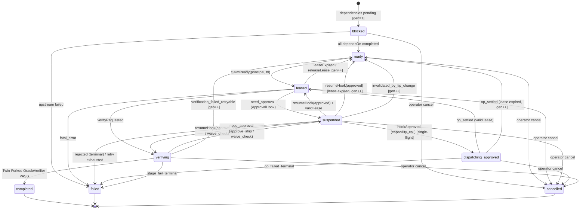
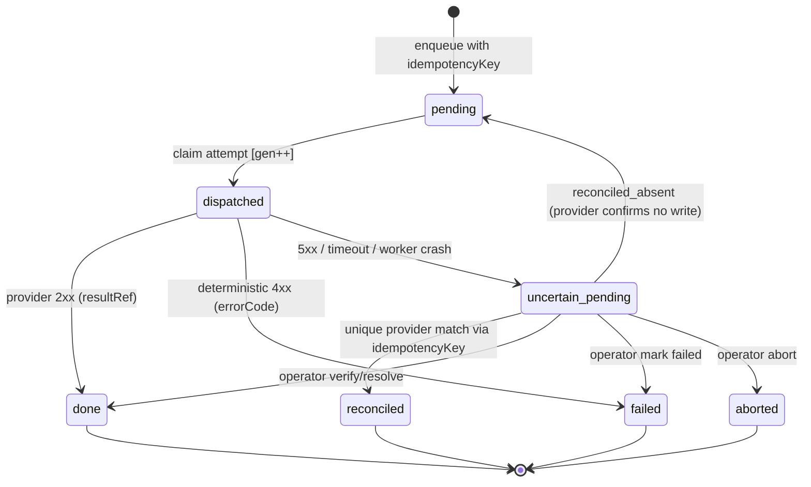
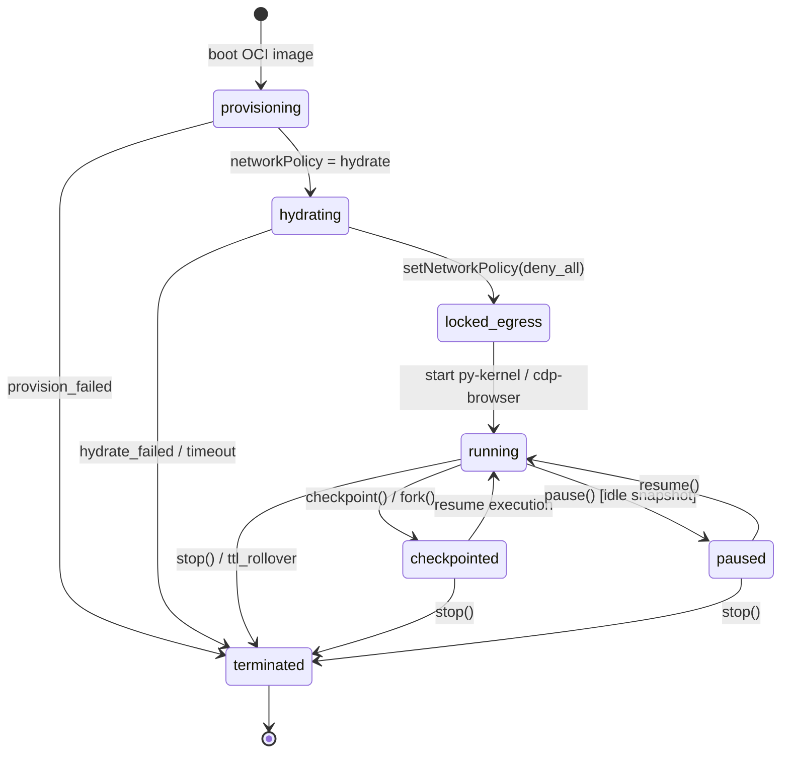

# Crucible — Normative Wire Protocols, Boundary Schemas & State Machines

> Companion specification to [`ARCHITECTURE.md`](../../ARCHITECTURE.md). Defines language-neutral JSON-Schema boundary contracts, wire-level RPC/HTTP/WebSocket protocols across the four cohesive units, Mermaid `stateDiagram-v2` lifecycles, trust invariants (`INV-01`–`INV-12`), and failure-mode recovery contracts.

---

## 1. Contract Philosophy & Language-Neutral Serialization

Crucible enforces strict wire coupling rather than shared-memory monorepo imports. Every contract below is normative over **UTF-8 JSON (RFC 8259)** with **canonical hashing (RFC 8785 JCS)** for digest binding:
- **Control & Coordination Plane (`control-plane`)** validates boundary payloads against JSON Schema Draft 2020-12 and generates TypeScript types.
- **Model & Authority Interception Proxy (`wire-proxy`)** enforces wire-level schemas, OIDC headers, ZDR flags, and HTTP status semantics.
- **Dual-Mode Execution Substrate (`execution-substrate`)** generates language-native typed DTOs and JSON-Schema validators (e.g., TypeScript interfaces and Python `TypedDict`) for Tier B (`py-kernel`, `cdp-browser`) and compact capability stubs for Tier A (`CodeMode Isolate`).
- **Operator Cockpit UI (`cockpit-ui`)** consumes read/action DTOs exclusively over `/control/*` REST and SSE.

---

## 2. Core Identity, TaskSpec & `PolicyGate` Schemas

### 2.1 Cryptographic Principal & Downward-Narrowing Delegation (`INV-03`, `INV-11`)

```json
{
  "$schema": "https://json-schema.org/draft/2020-12/schema",
  "$id": "https://crucible.spec/schemas/principal-delegation.json",
  "title": "PrincipalAndDelegation",
  "type": "object",
  "required": ["principal", "attestation"],
  "additionalProperties": false,
  "properties": {
    "principal": {
      "type": "object",
      "required": ["principalId", "sessionId", "role", "authMethod", "keyId"],
      "additionalProperties": false,
      "properties": {
        "principalId": { "type": "string", "minLength": 1 },
        "sessionId": { "type": "string", "minLength": 1 },
        "role": { "type": "string", "enum": ["operator", "lead", "builder", "verifier", "reviewer", "curator", "observer"] },
        "authMethod": { "type": "string", "enum": ["operator_token", "oidc", "mtls", "worker_key"] },
        "keyId": { "type": "string", "minLength": 1 }
      }
    },
    "delegationGrant": {
      "type": "object",
      "required": ["grantId", "parentGrantId", "allowedBindings", "maxEffect", "inheritedHookIds"],
      "additionalProperties": false,
      "properties": {
        "grantId": { "type": "string", "minLength": 1 },
        "parentGrantId": { "type": ["string", "null"], "minLength": 1 },
        "allowedBindings": { "type": "array", "items": { "type": "string", "minLength": 1 } },
        "allowedMethods": { "type": "object", "additionalProperties": { "type": "array", "items": { "type": "string", "minLength": 1 } } },
        "maxEffect": { "type": "string", "enum": ["read", "write"] },
        "inheritedHookIds": { "type": "array", "items": { "type": "string", "minLength": 1 } }
      }
    },
    "attestation": {
      "type": "object",
      "required": ["algorithm", "keyId", "payloadDigest", "signature", "issuedAt"],
      "additionalProperties": false,
      "properties": {
        "algorithm": { "type": "string", "enum": ["ed25519", "hmac-sha256"] },
        "keyId": { "type": "string", "minLength": 1 },
        "payloadDigest": { "type": "string", "pattern": "^[0-9a-f]{64}$" },
        "signature": { "type": "string", "minLength": 1 },
        "issuedAt": { "type": "string", "format": "date-time" }
      }
    }
  }
}
```

**Normative Invariants (`INV-03`, `INV-11`):**
1. **Independence Rule:** A `verifier`, `reviewer`, or `curator` principal $P$ is admissible if and only if: (a) `attestation.signature` verifies against `control-plane` keyring for `payloadDigest === sha256(canonicalJson(payload))`, (b) `P.principalId` is absent from `run.authorPrincipals` across all sessions/hosts, and (c) `P.role !== "builder"`.
2. **Downward-Narrowing Delegation:** Root grants set `parentGrantId: null`. When spawning a child `WorkItem`, `child.delegationGrant.parentGrantId` MUST equal `parent.delegationGrant.grantId`, `child.delegationGrant.allowedBindings` MUST be a subset of `parent.allowedBindings`, for every binding $b$ present in `child.delegationGrant.allowedMethods`, $b \in \text{child.allowedBindings}$ and `child.allowedMethods[b]` MUST be a subset of `parent.allowedMethods[b]` (whenever `parent.allowedMethods` constrains $b$, and inheriting `parent.allowedMethods[b]` if omitted on child), `child.maxEffect <= parent.maxEffect`, and `child.inheritedHookIds` MUST contain all entries from `parent.inheritedHookIds`.
3. **Operator Authority:** Only `authMethod` in `["operator_token", "oidc"]` with verified `role === "operator"` may resolve `ApprovalHook`s or promote `/refine` proposals.

### 2.2 `TaskSpec`, `Subject`, `PolicyGate`, `ReviewVerdict`, `RefinementProposal` & `ProofCommit` (`INV-05`, `INV-08`, `INV-12`)

```json
{
  "$schema": "https://json-schema.org/draft/2020-12/schema",
  "$id": "https://crucible.spec/schemas/task-spec-and-decision.json",
  "title": "TaskSpecAndDecision",
  "oneOf": [
    { "$ref": "#/$defs/TaskSpec" },
    { "$ref": "#/$defs/DecisionInput" },
    { "$ref": "#/$defs/DecisionOutput" },
    { "$ref": "#/$defs/ProofArtifact" },
    { "$ref": "#/$defs/ProofCommit" },
    { "$ref": "#/$defs/ReviewVerdict" },
    { "$ref": "#/$defs/RefinementProposal" },
    { "$ref": "#/$defs/Subject" }
  ],
  "$defs": {
    "ChangeClass": { "type": "string", "enum": ["bugfix", "greenfield", "refactor", "docs"] },
    "RiskProfile": { "type": "string", "enum": ["read_only", "standard", "verified", "critical"] },
    "EnvironmentTarget": { "type": "string", "enum": ["sandbox", "preview", "staging", "production"] },
    "ArtifactRef": { "type": "string", "pattern": "^artifact://sha256:[0-9a-f]{64}$" },
    "Principal": {
      "type": "object",
      "required": ["principalId", "sessionId", "role", "authMethod", "keyId"],
      "additionalProperties": false,
      "properties": {
        "principalId": { "type": "string", "minLength": 1 },
        "sessionId": { "type": "string", "minLength": 1 },
        "role": { "type": "string", "enum": ["operator", "lead", "builder", "verifier", "reviewer", "curator", "observer"] },
        "authMethod": { "type": "string", "enum": ["operator_token", "oidc", "mtls", "worker_key"] },
        "keyId": { "type": "string", "minLength": 1 }
      }
    },
    "Attestation": {
      "type": "object",
      "required": ["algorithm", "keyId", "payloadDigest", "signature", "issuedAt"],
      "additionalProperties": false,
      "properties": {
        "algorithm": { "type": "string", "enum": ["ed25519", "hmac-sha256"] },
        "keyId": { "type": "string", "minLength": 1 },
        "payloadDigest": { "type": "string", "pattern": "^[0-9a-f]{64}$" },
        "signature": { "type": "string", "minLength": 1 },
        "issuedAt": { "type": "string", "format": "date-time" }
      }
    },
    "Subject": {
      "oneOf": [
        {
          "type": "object",
          "required": ["kind", "repos", "changeClass", "riskProfile"],
          "additionalProperties": false,
          "properties": {
            "kind": { "const": "code" },
            "repos": {
              "type": "array",
              "minItems": 1,
              "items": {
                "type": "object",
                "required": ["repoId", "baseSha", "headSha", "dirtyTree", "baseIsStrictAncestorOfHead"],
                "additionalProperties": false,
                "properties": {
                  "repoId": { "type": "string", "minLength": 1 },
                  "baseSha": { "type": "string", "pattern": "^[0-9a-f]{40}$" },
                  "headSha": { "type": "string", "pattern": "^[0-9a-f]{40}$" },
                  "dirtyTree": { "type": "boolean" },
                  "baseIsStrictAncestorOfHead": { "type": "boolean" }
                }
              }
            },
            "changeClass": { "$ref": "#/$defs/ChangeClass" },
            "riskProfile": { "$ref": "#/$defs/RiskProfile" }
          }
        },
        {
          "type": "object",
          "required": ["kind", "docDigest", "declaredCheckDigests", "changeClass", "riskProfile"],
          "additionalProperties": false,
          "properties": {
            "kind": { "const": "document" },
            "docDigest": { "type": "string", "pattern": "^[0-9a-f]{64}$" },
            "declaredCheckDigests": { "type": "array", "minItems": 1, "items": { "type": "string", "pattern": "^[0-9a-f]{64}$" } },
            "changeClass": { "const": "docs" },
            "riskProfile": { "$ref": "#/$defs/RiskProfile" }
          }
        }
      ]
    },
    "HookOutcome": {
      "type": "object",
      "required": ["hookId", "phase", "status"],
      "additionalProperties": false,
      "properties": {
        "hookId": { "type": "string", "minLength": 1 },
        "phase": { "type": "string", "enum": ["pre_call", "post_call", "approval_request"] },
        "status": { "type": "string", "enum": ["ok", "timeout", "error", "malformed"] },
        "verdict": { "type": "string", "enum": ["allow", "deny", "ask"] },
        "reasonCode": { "type": "string" }
      }
    },
    "TaskSpec": {
      "type": "object",
      "required": ["specId", "specVersion", "specHash", "targetEnvironment", "subject", "rubricRef", "scoringMode", "maxAsyncStaleness", "policyRuleIds", "hookIds"],
      "additionalProperties": false,
      "properties": {
        "specId": { "type": "string", "minLength": 1 },
        "specVersion": { "type": "string", "minLength": 1 },
        "specHash": { "type": "string", "pattern": "^[0-9a-f]{64}$" },
        "targetEnvironment": { "$ref": "#/$defs/EnvironmentTarget" },
        "subject": { "$ref": "#/$defs/Subject" },
        "rubricRef": { "$ref": "#/$defs/ArtifactRef" },
        "scoringMode": { "type": "string", "enum": ["isolated", "shared_read_only"] },
        "maxAsyncStaleness": { "type": "integer", "minimum": 0 },
        "policyRuleIds": { "type": "array", "items": { "type": "string", "minLength": 1 } },
        "hookIds": { "type": "array", "items": { "type": "string", "minLength": 1 } }
      }
    },
    "ProofArtifact": {
      "type": "object",
      "required": ["id", "runId", "checkId", "specHash", "subjectHash", "phase", "verdict", "status", "dirtyTree", "artifactDurable", "principal", "attestation", "journalSeq"],
      "additionalProperties": false,
      "properties": {
        "id": { "type": "string", "minLength": 1 },
        "runId": { "type": "string", "minLength": 1 },
        "checkId": { "type": "string", "minLength": 1 },
        "specHash": { "type": "string", "pattern": "^[0-9a-f]{64}$" },
        "subjectHash": { "type": "string", "pattern": "^[0-9a-f]{64}$" },
        "phase": { "type": "string", "enum": ["reproduce", "before", "mutation_probe", "after", "deployed", "manual"] },
        "verdict": { "type": "string", "enum": ["PASS", "FAIL", "REPRODUCED", "NOT_REPRODUCED", "BLOCKED"] },
        "status": { "type": "string", "enum": ["active", "invalidated_by_tip_change"] },
        "blockedCause": { "type": "string", "enum": ["login_wall", "bot_challenge", "missing_artifact_bytes", "worker_unavailable", "semantic_http_200_failure", "egress_denied", "timeout"] },
        "dirtyTree": { "type": "boolean" },
        "artifactRef": { "$ref": "#/$defs/ArtifactRef" },
        "artifactDurable": { "type": "boolean" },
        "principal": { "$ref": "#/$defs/Principal" },
        "attestation": { "$ref": "#/$defs/Attestation" },
        "journalSeq": { "type": "integer", "minimum": 0 }
      }
    },
    "ProofCommit": {
      "type": "object",
      "required": ["runId", "subjectHash", "specSetHash", "afterArtifactHash", "traceRootHash", "verifierPrincipalId", "attestation"],
      "additionalProperties": false,
      "properties": {
        "runId": { "type": "string", "minLength": 1 },
        "subjectHash": { "type": "string", "pattern": "^[0-9a-f]{64}$" },
        "specSetHash": { "type": "string", "pattern": "^[0-9a-f]{64}$" },
        "beforeArtifactHash": { "type": "string", "pattern": "^[0-9a-f]{64}$" },
        "afterArtifactHash": { "type": "string", "pattern": "^[0-9a-f]{64}$" },
        "traceRootHash": { "type": "string", "pattern": "^[0-9a-f]{64}$" },
        "verifierPrincipalId": { "type": "string", "minLength": 1 },
        "attestation": { "$ref": "#/$defs/Attestation" }
      }
    },
    "ReviewVerdict": {
      "type": "object",
      "required": ["reviewId", "runId", "subjectHash", "reviewerPrincipal", "verdict", "status", "attestation"],
      "additionalProperties": false,
      "properties": {
        "reviewId": { "type": "string", "minLength": 1 },
        "runId": { "type": "string", "minLength": 1 },
        "subjectHash": { "type": "string", "pattern": "^[0-9a-f]{64}$" },
        "reviewerPrincipal": { "$ref": "#/$defs/Principal" },
        "verdict": { "type": "string", "enum": ["APPROVE", "CHANGES_REQUESTED", "REJECT"] },
        "status": { "type": "string", "enum": ["active", "invalidated_by_tip_change"] },
        "commentsRef": { "$ref": "#/$defs/ArtifactRef" },
        "attestation": { "$ref": "#/$defs/Attestation" }
      }
    },
    "RefinementProposal": {
      "type": "object",
      "required": ["proposalId", "runId", "authorPrincipalId", "targetKind", "targetId", "citedTraceNodeIds", "canaryEvalPassRate", "maxAsyncStaleness", "status", "attestation"],
      "additionalProperties": false,
      "properties": {
        "proposalId": { "type": "string", "minLength": 1 },
        "runId": { "type": "string", "minLength": 1 },
        "authorPrincipalId": { "type": "string", "minLength": 1 },
        "curatorPrincipalId": { "type": "string", "minLength": 1 },
        "targetKind": { "type": "string", "enum": ["memory_note", "helper_skill", "subagent_template"] },
        "targetId": { "type": "string", "minLength": 1 },
        "citedTraceNodeIds": { "type": "array", "minItems": 1, "items": { "type": "string", "minLength": 1 } },
        "canaryEvalPassRate": { "type": "number", "minimum": 0, "maximum": 1 },
        "maxAsyncStaleness": { "type": "integer", "minimum": 0 },
        "status": { "type": "string", "enum": ["proposed", "canary_eval", "awaiting_curation", "promoted", "rolled_back", "rejected"] },
        "rollbackSnapshotRef": { "$ref": "#/$defs/ArtifactRef" },
        "attestation": { "$ref": "#/$defs/Attestation" }
      }
    },
    "DecisionInput": {
      "type": "object",
      "required": ["nowUtc", "pinnedVersions", "principal", "workItemGeneration", "actionType", "hookOutcomes"],
      "additionalProperties": false,
      "properties": {
        "nowUtc": { "type": "string", "format": "date-time" },
        "pinnedVersions": {
          "type": "object",
          "required": ["specVersion", "policyVersion", "harnessVersion", "deploymentVersion"],
          "additionalProperties": false,
          "properties": {
            "specVersion": { "type": "string", "minLength": 1 },
            "policyVersion": { "type": "string", "minLength": 1 },
            "harnessVersion": { "type": "string", "minLength": 1 },
            "deploymentVersion": { "type": "string", "minLength": 1 }
          }
        },
        "principal": { "$ref": "#/$defs/Principal" },
        "delegationGrantId": { "type": "string", "minLength": 1 },
        "workItemGeneration": { "type": "integer", "minimum": 1 },
        "actionType": { "type": "string", "enum": ["capability_call", "workflow_transition", "work_item_transition", "refine_promotion", "trace_promotion"] },
        "binding": { "type": "string" },
        "method": { "type": "string" },
        "canonicalArgs": { "type": "object" },
        "subject": { "$ref": "#/$defs/Subject" },
        "proofArtifacts": { "type": "array", "items": { "$ref": "#/$defs/ProofArtifact" } },
        "reviewVerdicts": { "type": "array", "items": { "$ref": "#/$defs/ReviewVerdict" } },
        "hookOutcomes": { "type": "array", "items": { "$ref": "#/$defs/HookOutcome" } },
        "asyncStalenessLevel": { "type": "integer", "minimum": 0 },
        "maxAsyncStaleness": { "type": "integer", "minimum": 0 }
      }
    },
    "DecisionOutput": {
      "type": "object",
      "required": ["disposition", "reasonCodes", "missingEvidence"],
      "additionalProperties": false,
      "properties": {
        "disposition": { "type": "string", "enum": ["allow", "deny", "need_fact", "need_approval", "blocked"] },
        "reasonCodes": { "type": "array", "items": { "type": "string" } },
        "missingEvidence": { "type": "array", "items": { "type": "string" } },
        "approvalBindingHash": { "type": "string", "pattern": "^[0-9a-f]{64}$" },
        "proofCommit": { "$ref": "#/$defs/ProofCommit" }
      }
    }
  }
}
```

#### Change-Class & Risk-Profile Verification Rules

| `ChangeClass` | `before` / `reproduce` Gate | `after` Gate | Invariant Guard |
|---|---|---|---|
| `bugfix` | `before` `FAIL` or `reproduce` `REPRODUCED` on strict ancestor `baseSha` (`before.journalSeq < after.journalSeq`) | Twin-Forked `Verifier Cell` `PASS` on clean `headSha`, identical `specHash`, `artifactDurable: true` | Rejects `baseSha === headSha` or `dirtyTree: true` |
| `greenfield` | `mutation_probe` `FAIL` when newly added behavior is inverted (`before.journalSeq < after.journalSeq`) | Twin-Forked `Verifier Cell` `PASS` on acceptance checks | Prevents tautological always-pass assertions |
| `refactor` | `PASS` on `baseSha` (`before.journalSeq < after.journalSeq`) | Twin-Forked `Verifier Cell` `PASS` on clean `headSha`, identical `specHash` | Blocks silent test deletion or coverage weakening |
| `docs` | Declared static/manual checks bound to `docDigest` | Non-author `APPROVE` `ReviewVerdict` bound to `docDigest` | Mutating `docDigest` invalidates prior approvals |

**`RiskProfile` Gate Modulation:**
- **`read_only`**: Permits `effect: "read"` capabilities only; external writes and ship transitions are denied.
- **`standard`**: Requires clean `headSha`/`docDigest`, `after` `PASS`, durable `artifactRef`, and semantic/ancestry sanity checks (`INV-12`); skips mandatory `before` falsification and operator ship gate.
- **`verified`**: Enforces full `ChangeClass` falsification + Twin-Forked `Verifier Cell` (`scoringMode: "isolated"`, `INV-11`) + non-author `ReviewVerdict` + operator `approve_ship` `ApprovalHook`.
- **`critical`**: All `verified` gates plus pre-implementation `approve_plan` `ApprovalHook` and post-deploy `deployed`/`manual` `PASS` verification.

#### Hook Execution vs. Pure `PolicyGate` Evaluation (`INV-05`, `INV-08`)

Crucible decouples **Hook Execution** (I/O) from **Policy Evaluation** (pure determinism):
1. **Memoized Hook Execution (`DurableEngine` `step`):** `pre_call` hooks execute inside a memoized `step` prior to `PolicyGate.evaluate()` (and `post_call` hooks execute inside a memoized `step` after dispatch), recording immutable `HookOutcome[]` entries (`{ hookId, phase, status: "ok" | "timeout" | "error" | "malformed", verdict?, reasonCode? }`) into the event journal. Any deadline overrun, exception, or malformed JSON is recorded deterministically as `timeout` / `error` / `malformed`.
2. **Pure Decision (`PolicyGate.evaluate(DecisionInput) -> DecisionOutput`):** Performs **zero I/O, zero network, and zero wall-clock reads** (consuming explicit `nowUtc`, pinned `{ specVersion, policyVersion, harnessVersion, deploymentVersion }`, and pre-recorded `hookOutcomes` from `DecisionInput`):
   - **Precedence & Fail-Closed Hooks:** Canonicalize arguments via `provider.canon()`, then evaluate all matching `PolicyRule`s and recorded `hookOutcomes` in strict precedence **`deny > ask > allow`**. Any recorded `HookOutcome` with `status` in `["timeout", "error", "malformed"]` resolves deterministically to `disposition: "deny"`.
   - **Async Staleness Bound (`maxAsyncStaleness`):** For `trace_promotion` and `refine_promotion`, `PolicyGate` / `OracleVerifier` verifies `asyncStalenessLevel <= taskSpec.maxAsyncStaleness`, returning `deny` (`stale_policy_drift`) if exceeded.
   - **Dispositions:** `"allow" | "deny" | "need_fact" | "need_approval" | "blocked"`, accompanied by `reasonCodes[]`, `missingEvidence[]`, optional `approvalBindingHash`, and optional `proofCommit`.

---

## 3. WorkBoard, `DurableEngine` & `TraceDAG` Contracts

### 3.1 `WorkBoard`, `ApprovalHook` & `OperationRequest` (`INV-06`, `INV-09`, `INV-10`)

```json
{
  "$schema": "https://json-schema.org/draft/2020-12/schema",
  "$id": "https://crucible.spec/schemas/coordination.json",
  "title": "CoordinationContracts",
  "oneOf": [
    { "$ref": "#/$defs/WorkItem" },
    { "$ref": "#/$defs/ApprovalHook" },
    { "$ref": "#/$defs/OperationRequest" }
  ],
  "$defs": {
    "WorkItem": {
      "type": "object",
      "required": ["id", "channelId", "runId", "title", "riskProfile", "status", "dependsOn", "delegationGrantId", "generation", "sequence"],
      "additionalProperties": false,
      "properties": {
        "id": { "type": "string", "minLength": 1 },
        "channelId": { "type": "string", "minLength": 1 },
        "runId": { "type": "string", "minLength": 1 },
        "title": { "type": "string", "minLength": 1 },
        "riskProfile": { "type": "string", "enum": ["read_only", "standard", "verified", "critical"] },
        "status": { "type": "string", "enum": ["blocked", "ready", "leased", "suspended", "dispatching_approved", "verifying", "completed", "failed", "cancelled"] },
        "dependsOn": { "type": "array", "items": { "type": "string" } },
        "delegationGrantId": { "type": "string", "minLength": 1 },
        "holderPrincipalId": { "type": "string" },
        "leaseToken": { "type": "string" },
        "leaseExpiresAt": { "type": "string", "format": "date-time" },
        "pendingApprovalHookId": { "type": "string" },
        "pendingOperationId": { "type": "string" },
        "generation": { "type": "integer", "minimum": 1 },
        "sequence": { "type": "integer", "minimum": 0 }
      }
    },
    "ApprovalHook": {
      "type": "object",
      "required": ["hookId", "runId", "kind", "status", "bindingHash", "canonicalPayload", "createdAt"],
      "additionalProperties": false,
      "properties": {
        "hookId": { "type": "string", "minLength": 1 },
        "runId": { "type": "string", "minLength": 1 },
        "workItemId": { "type": "string" },
        "kind": { "type": "string", "enum": ["capability_call", "approve_plan", "approve_ship", "waive_check", "unblock_question", "promote_refine"] },
        "status": { "type": "string", "enum": ["pending", "approved", "rejected", "expired", "invalidated_by_tip_change"] },
        "bindingHash": { "type": "string", "pattern": "^[0-9a-f]{64}$" },
        "canonicalPayload": { "type": "object" },
        "createdAt": { "type": "string", "format": "date-time" }
      }
    },
    "OperationRequest": {
      "type": "object",
      "required": ["operationId", "idempotencyKey", "runId", "expectedSequence", "binding", "method", "canonicalArgs", "subjectHash", "status", "currentGeneration"],
      "additionalProperties": false,
      "properties": {
        "operationId": { "type": "string", "minLength": 1 },
        "idempotencyKey": { "type": "string", "minLength": 16 },
        "runId": { "type": "string", "minLength": 1 },
        "expectedSequence": { "type": "integer", "minimum": 0 },
        "approvalHookId": { "type": "string" },
        "approvalAttestationDigest": { "type": "string", "pattern": "^[0-9a-f]{64}$" },
        "binding": { "type": "string", "minLength": 1 },
        "method": { "type": "string", "minLength": 1 },
        "canonicalArgs": { "type": "object" },
        "subjectHash": { "type": "string", "pattern": "^[0-9a-f]{64}$" },
        "status": { "type": "string", "enum": ["pending", "dispatched", "done", "failed", "aborted", "uncertain_pending", "reconciled"] },
        "currentGeneration": { "type": "integer", "minimum": 1 },
        "resultRef": { "type": "string", "pattern": "^artifact://sha256:[0-9a-f]{64}$" },
        "errorCode": { "type": "string" }
      }
    }
  }
}
```

### 3.2 `ModelGateway`, `SemanticGuard` & $O(n)$ `TraceDAG` (`INV-04`, `INV-08`, `INV-12`)

```json
{
  "$schema": "https://json-schema.org/draft/2020-12/schema",
  "$id": "https://crucible.spec/schemas/trace-dag.json",
  "title": "TraceDAGAndModelCall",
  "type": "object",
  "required": ["nodeId", "runId", "parentNodeIds", "nodeKind", "pinnedVersions", "asyncStalenessLevel", "corrupted"],
  "additionalProperties": false,
  "properties": {
    "nodeId": { "type": "string", "minLength": 1 },
    "runId": { "type": "string", "minLength": 1 },
    "parentNodeIds": { "type": "array", "items": { "type": "string" } },
    "nodeKind": { "type": "string", "enum": ["model_call", "capability_rpc", "repl_exec", "cdp_event", "compaction_boundary", "verification"] },
    "pinnedVersions": {
      "type": "object",
      "required": ["specVersion", "policyVersion", "harnessVersion", "deploymentVersion"],
      "additionalProperties": false,
      "properties": {
        "specVersion": { "type": "string" },
        "policyVersion": { "type": "string" },
        "harnessVersion": { "type": "string" },
        "deploymentVersion": { "type": "string" }
      }
    },
    "asyncStalenessLevel": { "type": "integer", "minimum": 0 },
    "maxAsyncStaleness": { "type": "integer", "minimum": 0 },
    "corrupted": { "type": "boolean" },
    "modelCall": {
      "type": "object",
      "required": ["callId", "captureMode", "virtualModel", "zdrEnforced", "httpStatus", "semanticStatus", "inputTokens", "outputTokens", "costUsd", "requestRef", "responseRef"],
      "additionalProperties": false,
      "properties": {
        "callId": { "type": "string", "minLength": 1 },
        "captureMode": { "type": "string", "enum": ["eval", "train"] },
        "virtualModel": { "type": "string" },
        "zdrEnforced": { "type": "boolean" },
        "httpStatus": { "type": "integer" },
        "semanticStatus": { "type": "string", "enum": ["ok", "empty_tool_args", "truncated_json", "refusal_on_200", "bot_challenge_200", "schema_mismatch"] },
        "inputTokens": { "type": "integer", "minimum": 0 },
        "outputTokens": { "type": "integer", "minimum": 0 },
        "tokenIds": { "type": "array", "items": { "type": "integer" } },
        "costUsd": { "type": "number", "minimum": 0 },
        "requestRef": { "type": "string", "pattern": "^artifact://sha256:[0-9a-f]{64}$" },
        "responseRef": { "type": "string", "pattern": "^artifact://sha256:[0-9a-f]{64}$" }
      }
    },
    "compactionManifest": {
      "type": "object",
      "additionalProperties": false,
      "properties": {
        "summaryRef": { "type": "string", "pattern": "^artifact://sha256:[0-9a-f]{64}$" },
        "preservedKernelSymbols": { "type": "array", "items": { "type": "string" } }
      }
    }
  }
}
```

---

## 4. Dual-Mode Execution Substrate Contracts

### 4.1 Tier A — `CodeMode Isolate` (`discover` + `run` + `artifact://`) (`INV-01`, `INV-02`)

- **Model-Facing Surface:** Exactly two descriptors (`discover`, `run`) totalling **$\le 1,200$ tokens**, invariant across 5 to 5,000+ granted methods.
- **Invocation Ownership:** `HarnessDriver` (inside a memoized `DurableEngine` `step`) invokes `POST /capabilities` on `CapabilityRelay`, which spawns the ephemeral Tier A `CodeMode Isolate` and mediates its secret-free host RPC stubs.
- **Lazy Schema Index:** `discover` binds `spec.index: SpecMethodIndexEntry[]` (`< 80 KB` for 2,000 endpoints) and `spec.describe(queries)` returning up to 25 `$ref`-resolved `MethodSchemaSlice` entries per call:

```json
{
  "$schema": "https://json-schema.org/draft/2020-12/schema",
  "$id": "https://crucible.spec/schemas/code-mode-spec.json",
  "title": "CodeModeSpecContracts",
  "oneOf": [
    { "$ref": "#/$defs/SpecMethodIndexEntry" },
    { "$ref": "#/$defs/MethodSchemaSlice" }
  ],
  "$defs": {
    "SpecMethodIndexEntry": {
      "type": "object",
      "required": ["binding", "methodId", "verb", "pathTemplate", "summary", "effect", "defaultDecision"],
      "additionalProperties": false,
      "properties": {
        "binding": { "type": "string", "minLength": 1 },
        "methodId": { "type": "string", "minLength": 1 },
        "verb": { "type": "string", "enum": ["GET", "POST", "PUT", "PATCH", "DELETE", "RPC"] },
        "pathTemplate": { "type": "string", "minLength": 1 },
        "summary": { "type": "string" },
        "effect": { "type": "string", "enum": ["read", "write"] },
        "defaultDecision": { "type": "string", "enum": ["allow", "ask", "deny"] }
      }
    },
    "MethodSchemaSlice": {
      "type": "object",
      "required": ["binding", "methodId", "inputSchema", "outputSchema", "requiresIdempotencyKey"],
      "additionalProperties": false,
      "properties": {
        "binding": { "type": "string", "minLength": 1 },
        "methodId": { "type": "string", "minLength": 1 },
        "effect": { "type": "string", "enum": ["read", "write"] },
        "requiresIdempotencyKey": { "type": "boolean" },
        "inputSchema": { "type": "object" },
        "outputSchema": { "type": "object" }
      }
    }
  }
}
```

- **Artifact Handle Bridge:** `run` binds `artifacts.put({ data, mediaType }) -> { ref: "artifact://sha256:...", bytes }` and `artifacts.get({ ref }) -> { data, mediaType }` scoped by `(runId, channelId)`.
- **Idempotency Mandate:** Every write-effect stub call inside `run` MUST pass a deterministic `idempotencyKey`.

### 4.2 Tier B — `MicroVM Cell`, `py-kernel` & `cdp-browser` (`BND-03`, `SLO-06`, `SLO-09`, `SLO-10`)

```json
{
  "$schema": "https://json-schema.org/draft/2020-12/schema",
  "$id": "https://crucible.spec/schemas/microvm-cell.json",
  "title": "MicroVMCellAndBrowserContracts",
  "oneOf": [
    { "$ref": "#/$defs/NetworkPolicy" },
    { "$ref": "#/$defs/ReplExecRequest" },
    { "$ref": "#/$defs/ReplExecResult" },
    { "$ref": "#/$defs/CdpBrowserSessionConfig" }
  ],
  "$defs": {
    "NetworkPolicy": {
      "oneOf": [
        {
          "type": "object",
          "required": ["mode", "allowHosts", "allowDns"],
          "additionalProperties": false,
          "properties": {
            "mode": { "const": "hydrate" },
            "allowHosts": { "type": "array", "minItems": 1, "items": { "type": "string", "minLength": 1 } },
            "allowDns": { "const": true }
          }
        },
        {
          "type": "object",
          "required": ["mode", "allowBrokerSocket", "allowDns", "blockedCidrs"],
          "additionalProperties": false,
          "properties": {
            "mode": { "const": "deny_all" },
            "allowBrokerSocket": { "const": true },
            "allowDns": { "const": false },
            "blockedCidrs": {
              "type": "array",
              "items": { "type": "string" },
              "allOf": [
                { "contains": { "const": "10.0.0.0/8" } },
                { "contains": { "const": "172.16.0.0/12" } },
                { "contains": { "const": "192.168.0.0/16" } },
                { "contains": { "const": "127.0.0.0/8" } },
                { "contains": { "const": "169.254.0.0/16" } },
                { "contains": { "const": "::1/128" } },
                { "contains": { "const": "fe80::/10" } },
                { "contains": { "const": "fc00::/7" } }
              ]
            }
          }
        }
      ]
    },
    "ReplExecRequest": {
      "type": "object",
      "required": ["cellId", "code", "timeoutMs", "reapOrphanProcs", "reapScope"],
      "additionalProperties": false,
      "properties": {
        "cellId": { "type": "string", "minLength": 1 },
        "code": { "type": "string" },
        "timeoutMs": { "type": "integer", "minimum": 100 },
        "reapOrphanProcs": { "type": "boolean" },
        "reapScope": { "type": "string", "enum": ["per_turn", "lease_boundary"] }
      }
    },
    "ReplExecResult": {
      "type": "object",
      "required": ["status", "stdoutPreview", "stderrPreview", "kernelSymbols", "durationMs"],
      "additionalProperties": false,
      "properties": {
        "status": { "type": "string", "enum": ["ok", "exception", "timeout", "oom_reset"] },
        "stdoutRef": { "type": "string", "pattern": "^artifact://sha256:[0-9a-f]{64}$" },
        "stderrRef": { "type": "string", "pattern": "^artifact://sha256:[0-9a-f]{64}$" },
        "stdoutPreview": { "type": "string" },
        "stderrPreview": { "type": "string" },
        "kernelSymbols": { "type": "array", "items": { "type": "string" } },
        "durationMs": { "type": "number", "minimum": 0 }
      }
    },
    "CdpBrowserSessionConfig": {
      "type": "object",
      "required": ["transportMode", "isolatedContext", "originAllowlist", "blockPrivateCidrs", "blockedCidrs", "dnsRebindingGuard", "enableWatchdogs"],
      "additionalProperties": false,
      "properties": {
        "transportMode": { "type": "string", "enum": ["local_vm_ws", "cloud_stealth_wss"] },
        "isolatedContext": { "const": true },
        "originAllowlist": { "type": "array", "minItems": 1, "items": { "type": "string", "minLength": 1 } },
        "blockPrivateCidrs": { "const": true },
        "blockedCidrs": {
          "type": "array",
          "items": { "type": "string" },
          "allOf": [
            { "contains": { "const": "10.0.0.0/8" } },
            { "contains": { "const": "172.16.0.0/12" } },
            { "contains": { "const": "192.168.0.0/16" } },
            { "contains": { "const": "127.0.0.0/8" } },
            { "contains": { "const": "169.254.0.0/16" } },
            { "contains": { "const": "::1/128" } },
            { "contains": { "const": "fe80::/10" } },
            { "contains": { "const": "fc00::/7" } }
          ]
        },
        "dnsRebindingGuard": { "const": true },
        "enableWatchdogs": {
          "type": "array",
          "items": { "type": "string", "enum": ["TargetWatchdog", "DownloadWatchdog", "SecurityWatchdog"] }
        }
      }
    }
  }
}
```

**Tier B Operational Guarantees (`reapScope` & `cdp-browser` Network Boundary):**
- **`reapScope` Semantics:** `reapOrphanProcs: true` with `reapScope: "lease_boundary"` permits legitimate intra-task background servers (e.g., `npm run dev &` driven by `cdp-browser`) to survive across turns of the same lease and deterministically reaps all task process groups before lease completion, `checkpoint()`/`fork()`, or VM teardown; `reapScope: "per_turn"` reaps immediately after each `replExec` call.
- **Guest Loopback vs. Outbound Egress (`BND-01`, `BND-03`):** Inside `MicroVM Cell`, `py-kernel` attaches to guest Chromium over guest-local loopback `ws://127.0.0.1:<port>` inside the isolated VM netns. `MicroVM Cell` stays strictly `deny_all` (`allowDns: false`, `0` direct TCP/UDP/DNS egress packets). ALL outbound browser navigation/fetch traffic and optional remote cloud stealth `wss://` CDP sessions traverse `allowBrokerSocket` (`vsock`/Unix socket) to host-side `BrowserEgressRelay` inside `Unit 2 (wire-proxy)`, where `CredentialVault` injects stealth-provider API keys and `BrowserEgressRelay` enforces `originAllowlist`, `blockPrivateCidrs`, and post-DNS-resolution IP pinning (`dnsRebindingGuard: true`).

---

## 5. Wire Protocols & Transport Endpoints

| Endpoint / Channel | Caller $\rightarrow$ Callee | Auth & CSRF | Request / Response Semantics |
|---|---|---|---|
| **Memoized `DurableEngine` Step Boundary** | `HarnessDriver` $\rightarrow$ `DurableEngine` | `runId`, pinned versions | Wraps all external I/O (`POST /v1/inference`, `POST /capabilities`, Host Hypervisor Supervisor APIs, In-Guest `vsock` RPCs, and `pre_call`/`post_call` lifecycle hooks) in deterministic memoized `step` journal records (`INV-08`). |
| **`POST /capabilities`** | `HarnessDriver` (via `step`) $\rightarrow$ `CapabilityRelay` | `Bearer <sessionToken>` bound to `(runId, channelId, delegationGrantId)` | Exposes byte-identical `discover` and `run` ($\le 1,200$ tokens, `INV-01`). Spawns Tier A `CodeMode Isolate` and returns `{ result, logs }` or `{ error: { kind: "load" \| "thrown" \| "refused" \| "approval_suspended" \| "deadline" \| "oom", hookId?, bindingHash?, message } }`. |
| **`POST /relay`** | `CodeMode Isolate` / `MicroVM` $\rightarrow$ `CapabilityRelay` | Ephemeral `X-Crucible-Snippet-Token` | `{ binding, method, input, idempotencyKey }`. Canonicalizes input $\rightarrow$ invokes `PolicyGate`. On `allow`: dispatches upstream with `CredentialVault` OIDC/BYOK. On `need_approval`: persists `ApprovalHook` + `OperationRequest`, parks `WorkItem` in `suspended`, returns **HTTP `409 approval_suspended`**. Tier A isolate engine **MUST abort immediately on `409`**. |
| **`POST /internal/policy/evaluate`** | `CapabilityRelay` $\leftrightarrow$ `PolicyGate` (`Unit 1`) | Mutual service token (`mTLS`) | Submits canonicalized `DecisionInput` (including memoized `HookOutcome[]`) to pure `PolicyGate.evaluate()` (`deny > ask > allow`, zero I/O, $p95 \le 25\text{ ms}$, `INV-05`). |
| **`POST /relay/spec/describe`** | `CodeMode Isolate` $\rightarrow$ `CapabilityRelay` | Ephemeral `X-Crucible-Snippet-Token` | Resolves up to 25 `{ binding, methodId }` `MethodSchemaSlice` payloads filtered by `delegationGrantId` (`INV-03`, `SLO-02`). |
| **`POST /relay/artifacts/put`**<br>**`GET /relay/artifacts/:sha256`** | `Execution Substrate` $\rightarrow$ `CapabilityRelay` $\rightarrow$ `ArtifactVault` (`Unit 1`) | Ephemeral `X-Crucible-Snippet-Token` | Writes fsynced CAS blobs with `(runId, channelId)` ACL grant; reads verify active grant (`INV-03`). |
| **Browser Egress Bridge (`vsock` $\rightarrow$ `BrowserEgressRelay`)** | `cdp-browser` (`MicroVM`) $\rightarrow$ `Unit 2 BrowserEgressRelay` | `allowBrokerSocket` + `CdpBrowserSessionConfig` | Relays outbound HTTP(S) target traffic and remote stealth `wss://` CDP sessions under `deny_all`; injects `CredentialVault` stealth keys (`BND-01`), enforces `originAllowlist`, `blockPrivateCidrs`, and post-DNS IP pinning, and runs `SemanticGuard` (`INV-12`). |
| **`POST /v1/inference`** | `HarnessDriver` (via `step`) $\rightarrow$ `ModelGateway` | Project short-lived OIDC token | Normalizes provider dialects, enforces `zeroDataRetention`, checks team/run budget (`402` on exhaustion), trips fleet circuit breakers, inspects HTTP-200 payloads via `SemanticGuard`, and appends to `TraceDAG`. |
| **`WorkBoard` CAS / Lease RPCs** | `HarnessDriver` / `DurableEngine` $\leftrightarrow$ `WorkBoard` | Principal `SignedAttestation` | `claimReady`, `renew`, `complete`, `wait`, `spawnChild`. Enforces `actionGeneration === currentGeneration` and `expectedSequence` CAS; stale writers receive **`409 Conflict / FencedWriter`** (`INV-09`). |
| **`GET/POST /control/*`** | `Operator Cockpit UI` $\rightarrow$ `control-plane` | `Bearer <operatorToken>` + `Origin` & `Sec-Fetch-Site: same-origin` | REST + SSE (`/control/events`). Drives `WorkBoard` views, `POST /control/hooks/:hookId/resolve`, `Stage` previews, and `/refine` curation. Hook resolution verifies `headSha`/`docDigest`, transitions `WorkItem` to `dispatching_approved`, and dispatches the single stored `OperationRequest` (`hookId` + `approvalAttestationDigest`). |
| **Host Hypervisor Supervisor API** | `control-plane` $\rightarrow$ `cell-runner` Host Supervisor | Host control socket (`mTLS` / Unix) | Drives `provision`, `setNetworkPolicy` (`hydrate` $\rightarrow$ `deny_all`), `checkpoint()` (unified with `snapshot()`), `fork()`, `pause()`, `resume()`, and `stop()` (`BND-03`, `SLO-06`). |
| **In-Guest `vsock` Daemon RPC** | `control-plane` $\leftrightarrow$ `MicroVM` Guest Daemon | `virtio-vsock` / `allowBrokerSocket` | Executes `replExec` (`py-kernel`) and `cdpAttach` (`cdp-browser`) inside `deny_all` (`allowDns: false`). Guest daemon never invokes hypervisor `fork()` or `setNetworkPolicy()`. |
| **Guest-Local CDP `ws://`** | `py-kernel` $\leftrightarrow$ `cdp-browser` | Isolated `BrowserContext` token | Raw typed CDP JSON-RPC over guest-local loopback `ws://127.0.0.1:<port>` inside the VM netns. |

---

## 6. Formal State Machines

### 6.1 `WorkBoard` `WorkItem` & Lease Lifecycle (`INV-06`, `INV-09`)

`WorkItem.generation` initializes at `1` upon creation (`blocked` / `ready`) so the first `claimReady` satisfies `OperationRequest.currentGeneration >= 1`.



### 6.2 `OperationRequest` & Uncertain-Write Reconciliation (`INV-10`)



### 6.3 `MicroVM Cell` & `/refine` Proposal Lifecycles (`BND-03`, `INV-11`)



**Continual Refinement (`/refine`) Lifecycle:**
`proposed` (cited `RefinementProposal` targeting candidate memory/skill) $\rightarrow$ `canary_eval` (offline `TraceDAG` replay suite with `asyncStalenessLevel <= taskSpec.maxAsyncStaleness`) $\rightarrow$ `awaiting_curation` (`authorPrincipalId !== curatorPrincipalId`) $\rightarrow$ `promoted` (`rollbackSnapshotRef` persisted; contradictory stale notes retired) | `rolled_back` | `rejected`.

---

## 7. Trust Invariants & Failure-Recovery Matrix (`INV-01`–`INV-12`)

| ID | Normative Invariant | Verification Gate | Deterministic Rejection / Recovery |
|---|---|---|---|
| **`INV-01`** | `discover` + `run` descriptors remain $\le 1,200$ tokens and byte-identical from 5 to 5,000+ endpoints. | `SLO-01` | Reject startup if descriptor byte hash varies across grant sizes. |
| **`INV-02`** | Tier A `CodeMode Isolate` starts empty (`globalOutbound: null`, zero fs/env) and tears down on exit or HTTP `409`. | `GATE-09` | Kill isolate immediately on `409`, OOM, or wall-clock deadline. |
| **`INV-03`** | Sessions discover/invoke only granted methods; subagents inherit parent hooks and strictly narrow grants (`allowedBindings` & `allowedMethods`). | `GATE-10` | Strip ungranted endpoints from `SpecIndex`; reject widening delegations. |
| **`INV-04`** | Zero static provider keys or signing secrets outside `CredentialVault`; `ZDR` & `402` enforced in `wire-proxy`. | `GATE-05` | Skip non-ZDR BYOK keys; return HTTP `402` on spend exhaustion. |
| **`INV-05`** | Memoized hook `step` records `HookOutcome[]`; pure `PolicyGate.evaluate()` runs zero I/O (`deny > ask > allow`) and fails closed. | `GATE-01`, `GATE-10` | Hook timeout/exception/malformed output resolves deterministically to `deny`. |
| **`INV-06`** | `need_approval` mints durable `ApprovalHook` + suspends at zero compute without blocking `/relay`; `dispatching_approved` prevents race re-claim. | `GATE-09` | Abort isolate immediately (`409`); snapshot/pause idle MicroVM. |
| **`INV-07`** | Untrusted workspaces cannot supply rules/hooks or execute local `.git/hooks/*` / `fsmonitor`. | `GATE-05` | Query bare mirrors with sanitized env (`core.hooksPath=/dev/null`). |
| **`INV-08`** | Replay core performs zero I/O; runs pin `(specVersion, policyVersion, harnessVersion, deploymentVersion)` and bound `maxAsyncStaleness`. | `GATE-01`, `GATE-03`, `GATE-08` | Tip/doc mutation marks prior proofs/hooks `invalidated_by_tip_change`; staleness overflow denies trace promotion. |
| **`INV-09`** | `WorkBoard` enforces single-holder TTL leases with monotonic `generation` fencing (`>= 1`) and `expectedSequence` CAS. | `GATE-06` | Reject stale writers with `409 Conflict / FencedWriter`. |
| **`INV-10`** | Every batched external write carries `idempotencyKey`; uncertain writes halt retries until reconciled (`reconciled` / `reconciled_absent`). | `GATE-06`, `GATE-07` | Hold `uncertain_pending` on ambiguous lookup; zero blind retries. |
| **`INV-11`** | `PrincipalIdentity` + `SignedAttestation` bind all proofs; `OracleVerifier` scores in clean `fork()`ed cell. | `GATE-02` | Reject self-verification (`AUTHOR_SELF_CERTIFIED`) regardless of role label. |
| **`INV-12`** | Empty SHAs, non-ancestors, missing bytes, bot walls, and HTTP-200 semantic mismatches yield `BLOCKED` or non-`ok` `semanticStatus`. | `GATE-04` | Never coerce `BLOCKED` (`semantic_http_200_failure`) or non-`ok` `semanticStatus` into `PASS`. |

---

*Master architecture and trust-zone topology live in [`ARCHITECTURE.md`](../../ARCHITECTURE.md). Primary-source synthesis, clean-slate supersession policy, and independent review rubric criteria live in [`PROVENANCE_AND_MIGRATION.md`](PROVENANCE_AND_MIGRATION.md).*
