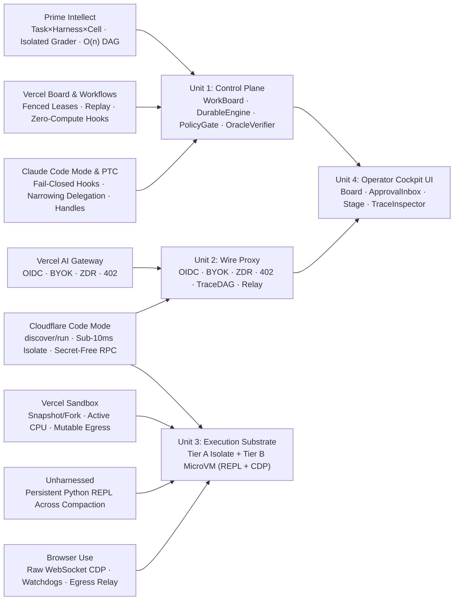

# Crucible — Clean-Slate Provenance, Synthesis Mapping & Supersession Policy

> Companion specification to [`ARCHITECTURE.md`](../../ARCHITECTURE.md) and [`CONTRACTS.md`](CONTRACTS.md). Documents how Crucible synthesizes seven primary architectural inspirations into original abstractions, declares the clean-slate supersession of all prior workspace prototypes, and establishes the independent architectural review rubric and falsifiable verification gates.

---

## 1. Inspiration Synthesis Topology & Provenance Mapping

Crucible neither copies external open-source implementations verbatim nor relies on third-party agent frameworks as core architectural primitives. Instead, each source lineage informs a specific boundary inside Crucible's four wire-coupled units:

### 1.1 Primary-Source Architectural Translation Table

| Inspiration Source | Reference URLs | Distilled Core Principle | Crucible Original Abstraction | Unit & Contract Anchor |
|---|---|---|---|---|
| **Prime Intellect** (`verifiers`, `prime-rl`, Sandboxes) | `github.com/PrimeIntellect-ai` | Orthogonal `TaskSpec × Harness × Cell` separation, `isolated` grader scoring, $O(n)$ DAG trajectories, bounded async staleness, `checkpoint()`/`fork()`/`pause()`/`resume()`, compact proof commits | **`OracleVerifier`** + **Twin-Forked Verifier Cell** + **`TraceDAG`** pinned to `(specVersion, policyVersion, harnessVersion)` + **`maxAsyncStaleness`** + **`ProofCommit`** | Unit 1 & Unit 2 (`CONTRACTS.md` §§2.2, 3.2) |
| **Cloudflare Code Mode** | `blog.cloudflare.com/code-mode/`, `blog.cloudflare.com/code-mode-mcp/` | Compact ~1,000-token progressive code surface over huge API catalogs, lazy schema slicing, sub-10ms stateless isolates (`globalOutbound: null`), secret-free host RPC stubs | **`discover` + `run` Surface** ($\le 1,200$ tokens), **lazy `$ref`-sliced `SpecIndex`**, **Tier A `CodeMode Isolate`**, **secret-free `CapabilityRelay`** with mandatory `idempotencyKey`s | Unit 2 & Unit 3 Tier A (`CONTRACTS.md` §§4.1, 5) |
| **Claude Code Mode & PTC** | `code.claude.com/docs/en/code-mode` | Programmatic orchestration keeping bulky intermediate state out of prompts, fail-closed per-call interception, pause/resume across host tool calls | **`ArtifactVault` (`artifact://sha256`) Handles**, **fail-closed `PolicyGate`** (pure `evaluate()` + memoized `HookOutcome[]`), **downward-narrowing delegation**, **`409` isolate abort + `ApprovalHook`** | Unit 1 & Unit 2 (`CONTRACTS.md` §§2.1, 2.2, 5) |
| **Unharnessed** | `github.com/unharnessed-agent/Unharnessed#why-one-tool` | Single-tool persistent Python REPL + async shell helper surviving conversation compaction without rigid tool truncation rules | **Tier B `py-kernel`** (`replExec`) inside hardware-isolated `MicroVM Cell`, guarded by cgroups RAM/PID caps, configurable `reapScope`, `checkpoint()` rollback, and **compaction variable manifests** | Unit 3 Tier B (`CONTRACTS.md` §4.2) |
| **Browser Use** | `github.com/browser-use/browser-use` | Persistent Python REPL paired with raw typed Chrome DevTools Protocol over WebSockets, hybrid DOM/AX + vision perception, watchdogs, and cloud stealth browsers | **Tier B `cdp-browser`** (guest `ws://` + `Unit 2 BrowserEgressRelay` over `vsock` for external HTTP(S)/stealth `wss://`), **`Target`/`Download`/`Security` Watchdogs**, fresh **isolated `BrowserContext`**, **`blockPrivateCidrs` + post-DNS IP pinning**, **HTTP-200 challenge wall detection** | Unit 3 Tier B & Unit 2 (`CONTRACTS.md` §§3.2, 4.2) |
| **Vercel Board & Workflows** | `vercel.com/blog/introducing-vercel-board`, `vercel.com/docs/workflow` | Headless channel/thread/DAG coordination with TTL leases & `wait` watchers; language-level split between deterministic replay core and memoized side-effect steps | **`WorkBoard`** (channels, threads, dependency DAG `WorkItem`s, generation-fenced TTL leases, non-polling `wait`, `dispatching_approved`) + **`DurableEngine`** (`workflow` replay vs. `step` outbox, `createHook`/`sleep`) | Unit 1 (`CONTRACTS.md` §§3.1, 6.1, 6.2) |
| **Vercel Sandbox & AI Gateway** | `vercel.com/docs/sandbox`, `vercel.com/docs/ai-gateway` | Firecracker microVMs with `snapshot()`/`fork()`, mutable `networkPolicy`, Active CPU billing; centralized OIDC/BYOK/ZDR inference proxy with `402` spend caps | **`MicroVM Cell`** (two-phase `hydrate` $\rightarrow$ `deny_all` + broker socket, idle snapshot rollover) + **`ModelGateway` / `CredentialVault` / `SemanticGuard`** | Unit 2 & Unit 3 Tier B (`CONTRACTS.md` §§3.2, 4.2, 6.3) |

---

## 2. Clean-Slate Supersession Policy

1. **Complete Architectural Break:** Crucible represents a ground-up redesign from first principles. Earlier single-language monorepo prototypes, hardcoded static package graphs, single-tier local risk labels, host-coupled isolate assumptions, and legacy enterprise adapter references found in prior workspace drafts are **categorically superseded and retired**.
2. **No Legacy Migration Ledgers:** Crucible specifications do not carry forward prior prototype module names, file-by-file defect patch lists, or legacy data-store schemas. All runtime boundaries, state machines, and contracts are governed solely by [`ARCHITECTURE.md`](../../ARCHITECTURE.md) and [`CONTRACTS.md`](CONTRACTS.md).
3. **Workspace Preservation During Blueprint Phase:** Existing prototype source files in the workspace remain untouched during the architectural specification phase; future implementation begins cleanly from the four wire-coupled units and language-neutral JSON-Schema contracts defined here.

---

## 3. Architectural Verification Gates & Independent Review Rubric

### 3.1 Verification Matrix Mapping (`INV-01`–`INV-12` $\rightarrow$ `GATE-01`–`GATE-10` & `SLO-01`–`SLO-10`)

| Verification Category | Applicable Gates & SLOs | Required Evidence |
|---|---|---|
| **Boundary & Secret Containment** | `GATE-05`, `SLO-02`, `SLO-04`, `SLO-06`, `SLO-10` | Canary secrets unreachable from Tier A/Tier B; zero leaked TCP/UDP/DNS packets in `deny_all`; private/loopback/link-local/ULA CIDRs (`blockPrivateCidrs`), DNS-rebinding redirects, and cross-tab cookie reads blocked by `BrowserEgressRelay`; Tier A cold load $p95 \le 15\text{ ms}$. |
| **Code Mode & Compaction Efficiency** | `GATE-08`, `GATE-09`, `SLO-01`, `SLO-03`, `SLO-08`, `SLO-09` | `discover` + `run` descriptor $\le 1,200$ tokens across 5–5,000+ endpoints; $O(n)$ `TraceDAG` linear storage growth; `asyncStalenessLevel <= maxAsyncStaleness` enforced; 100% `py-kernel` live variable retention across transcript compaction; instant `409` isolate abort. |
| **Durability, Fencing & Reconciliation** | `GATE-01`, `GATE-06`, `GATE-07`, `SLO-05` | Byte-identical offline deterministic replay (with memoized `HookOutcome[]`); single-PR recovery after mid-dispatch crash; safe `reconciled_absent` retry vs. zero blind retries on `uncertain_pending`; hook resume $p95 \le 500\text{ ms}$ with `0` idle compute. |
| **Delegation, Verification & Honesty** | `GATE-02`, `GATE-03`, `GATE-04`, `GATE-10`, `SLO-07` | 100% rejection of self-verification and forged attestations; Twin-Forked `Verifier Cell` unaffected by solver workspace tampering; subagents strictly narrow parent grants (`allowedBindings` & `allowedMethods`) and inherit hooks; HTTP-200 bot walls and truncated JSON yield `BLOCKED` (`semantic_http_200_failure`) or non-`ok` `ModelCall.semanticStatus`. |

### 3.2 Independent Architectural Review Rubric

An independent, non-author reviewer evaluates the Crucible blueprint against four mandatory PASS/FAIL criteria:

1. **Clean-Slate Originality:** Zero fitting to legacy monolithic TypeScript package layouts, obsolete local store prototypes, or retired risk/zone taxonomies; language and packaging choices follow directly from workload and isolation first principles.
2. **Cohesive Multi-Source Synthesis:** All seven inspirations (Prime Intellect, Cloudflare Code Mode, Claude Code Mode & PTC, Unharnessed, Browser Use, Vercel Board/Workflows, and Vercel Sandbox/AI Gateway) are integrated into unified, original abstractions with clear trust boundaries and failure-mode mitigations—without verbatim code/prose copying or third-party framework lock-in.
3. **Production Rigor & Cross-Document Consistency:** Component names, wire endpoints, invariants (`INV-01`–`INV-12`), gates (`GATE-01`–`GATE-10`), SLOs (`SLO-01`–`SLO-10`), JSON Schemas, and Mermaid `stateDiagram-v2` lifecycles align across [`ARCHITECTURE.md`](../../ARCHITECTURE.md), [`CONTRACTS.md`](CONTRACTS.md), and this specification with zero contradictions or broken links.
4. **Diagram Clarity & Render Integrity:** Every Mermaid diagram—especially [`ARCHITECTURE.md` §2.1](../../ARCHITECTURE.md#21-high-level-topology--trust-zones)—passes automated parser/renderer validation and exhibits clear hierarchy, concise multi-line labels, uncluttered edges, and zero orphan nodes.
